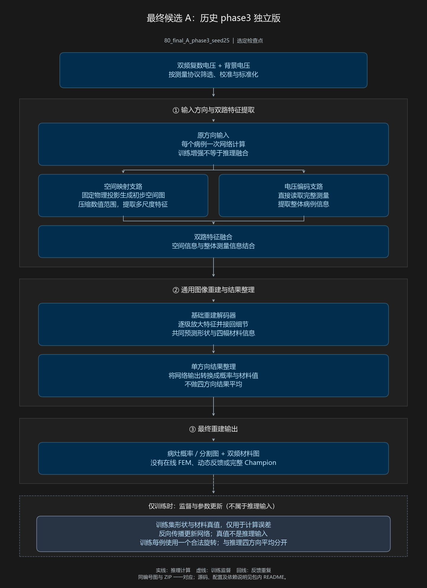
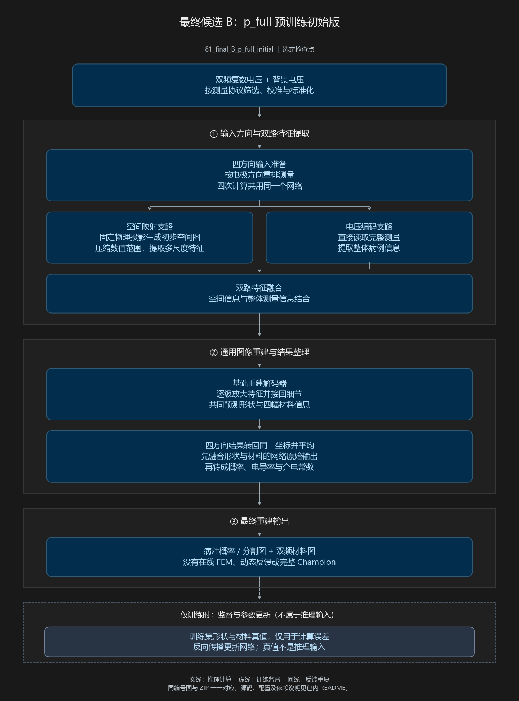

# EIT 模型演进档案 | Model History Archive

从 V4 开始的电阻抗成像（Electrical Impedance Tomography, EIT）重建模型代码、中文流程图与配置索引。

**[打开在线模型资料库 →](https://vagrancy77.github.io/eit-model-archive-v4/)** · **[下载流程图 PDF 合集](https://vagrancy77.github.io/eit-model-archive-v4/output/pdf/V4_model_history.pdf)** · **[完整版本索引](site/VERSION_INDEX.md)**

本项目把演进过程中的模型、输入／损失对照、诊断候选、训练阶段与发布快照整理成一一对应的档案，便于查看、下载和追溯。网站无需登录 GitHub 或 ChatGPT，也不依赖作者电脑开机。

> **83 个版本／配置条目 ≠ 83 个不同网络架构。** 同架构的训练版本、推理配置、消融和历史发布别名均作明确区分。本仓库是代码档案和浏览入口，不是下载后即可运行全部实验的一键复现环境。

## 快速使用

1. 打开上方在线资料库，用关键词搜索版本、模块或配置。
2. 按类别筛选，点击“查看对应流程图”，或展开当前筛选结果的全部图件。
3. 使用同一条目中的“下载对应代码包”“PNG 图”“SVG 图”和“配置与路径”，保持编号对应。
4. 运行代码前，先阅读 ZIP 内说明、依赖、配置、许可和源码清单，准备所需权重、数据与数值算子。历史路径不能直接用于另一台电脑。

## 归档范围

| 条目 | 内容 |
| --- | --- |
| 01–16 | 早期 V4/V5/V6、导入 V4、不同数据与电压输入对照 |
| 17–22 | 旧 V4 的单轮反馈、固定三轮联合微调及长训分支 |
| 23–33 | 局部形状恢复诊断、概率修正和 K3 集成验证 |
| 34–44 | 通用形状映射、固定物理投影与训练方向增强 |
| 45–48 | 完整 Champion 和反馈／自适应接口原型 |
| 49–69 | 21 组短训方案，包括初始化及训练后记录 |
| 70–71 | 已被取代的历史发布快照，不作为新增架构 |
| 72–79 | 完整旧 V4 闭环 + Champion 共同底座的 8 组短训 |
| 80–83 | 最终候选 A/B、A 同权重推理对照及后续训练冻结版 |

## 两个最终候选的快捷入口

| 候选 | 说明 | 流程图 | 代码包 |
| --- | --- | --- | --- |
| A：历史 phase3 独立版（80） | 固定投影路线，选定 seed20261025 的 best；单次推理 | [查看](https://vagrancy77.github.io/eit-model-archive-v4/diagrams/80_final_A_phase3_seed25.svg) | [ZIP](https://vagrancy77.github.io/eit-model-archive-v4/packages/80_final_A_phase3_seed25_code.zip) |
| B：p_full 预训练初始版（81） | 源于 seed20261023 父模型；推理时四方向变换、对齐及融合 | [查看](https://vagrancy77.github.io/eit-model-archive-v4/diagrams/81_final_B_p_full_initial.svg) | [ZIP](https://vagrancy77.github.io/eit-model-archive-v4/packages/81_final_B_p_full_initial_code.zip) |

A 与 B 的父权重、随机种子和训练历史不同，不能把它们的差异全部归因于四方向融合。A 同权重的四方向推理对照另列为条目 82。

<details>
<summary>展开预览：候选 A 的中文流程图</summary>



</details>

<details>
<summary>展开预览：候选 B 的中文流程图</summary>



</details>

## 文件与目录

```text
site/
  index.html           搜索、筛选与逐版本浏览页面
  catalog.json         83 项目录和代码包哈希
  VERSION_INDEX.md     完整版本索引
  diagrams/            同编号 PNG / SVG 流程图
  packages/            83 个独立代码 ZIP
  records/             版本配置与来源记录
  output/pdf/          87 页流程图合集
  REVIEW_LOG.md        分步审阅与修订记录
  PACKAGING_QA.json    原始打包核验记录
.github/workflows/     GitHub Pages 静态发布流程
```

**包含：** 已归档源码、配置和来源说明、权重位置记录、源码 SHA256 清单、图件及原有许可文件。

**不包含：** 训练权重、数据集、数值算子数组、完整运行环境。版本记录中的 `E:/Codex/...` 是历史来源信息，不是访问网站所需的路径。只想查看某个模型时，建议下载对应 ZIP，不必克隆整个资料库。

## 阅读与复现注意事项

- 固定物理投影不等于推理时执行非线性 FEM 正问题；训练四方向增强不等于推理四方向融合。
- 输入置零、损失删除和从头训练更小网络是不同实验，不能混为同一种消融。
- 历史 FEM 与后来修订的像素覆盖版本要区分；不能声称所有历史求解器均与原 COMSOL 完全等价。
- 原型、未完成训练分支、已取代发布快照按实际状态保留；出现在目录中不代表已通过完整训练或性能验收。
- 本网站仅提供静态浏览和下载，没有在线训练、推理或 FEM 服务。不要未经检查运行历史训练启动器。
- 各 ZIP 保留原有许可与第三方代码说明；本仓库不另行授予覆盖全部归档内容的统一许可证。使用或再分发前请检查对应文件。

## 发布与完整性

网站由 GitHub Pages 托管，通过仓库的 [Actions](https://github.com/vagrancy77/eit-model-archive-v4/actions) 发布 `site/` 内容。迁移保留代码包和流程图字节；PDF 的封面入口及 83 个下载链接改为本 GitHub Pages 地址。

仓库公开不等于所有地区、运营商或 IP 都保证可达；实际连通性受当地网络条件影响。如遇到失效链接或编号不对应，可在 [Issues](https://github.com/vagrancy77/eit-model-archive-v4/issues) 中提供条目编号和问题描述，请勿上传密码、令牌或未获授权的数据。

---

**English overview.** This repository archives EIT reconstruction research from V4 onward: 83 version/configuration records, paired Chinese flowcharts, and source-code ZIPs. It distinguishes architectures, ablations, training histories, inference settings and superseded releases. Checkpoints, datasets and numerical operators are not included. The static gallery supports browsing and downloading without signing in; the archive is not a turnkey reproduction package or a clinical validation claim.
