# 从 V4 开始的模型代码与对应流程图

共 **83 个版本／配置条目**，每项一张 PNG、一张 SVG 和一个独立代码 ZIP；不是 83 个完全不同的网络架构。ZIP 总计约 525.5 MiB。

推荐先打开 `index.html`：可搜索、筛选和逐项查看“版本说明 → 流程图 → 代码包”。

## 交付边界

- 已纳入早期 V4/V5/V6、导入 COMSOL V4、本地双频 V4、K1/K3、外凸诊断、通用形状三阶段、完整 Champion、反馈与自适应版本、21 组短训、8 组共同底座、历史发布快照、最终 A/B 及后续四方向长训版。
- 每项是独立归档；共享源代码会重复包含，以避免只发差异文件而漏掉公共底座。
- **代码包不包含数据、权重或数值算子。** 原权重位置记录于包内 `WEIGHT_LOCATIONS.json`，原检查点哈希记录保留在原始元数据内。最终 A/B 已有含权重的完整包仍位于 `E:/Codex/model_packages_20261028/`。
- 未运行训练、推理或 FEM，未改历史源码。旧绝对路径／旧入口保持原样，运行前需恢复外部依赖；没有把源码归档冒称可移植部署验收。
- 每张图采用之前的深色、分阶段、蓝色模块框与通俗中文，图中的训练目标与推理计算分开。

## 不额外当成新模型的条目

- **随机种子、best/last/initial/epoch 检查点**：同一配置内作为权重实例列出，不各自虚构新架构。
- **数据集 V6_3872 / V6_4840**：数据集版本不是神经网络 V6。
- **早期 V6 未修正评估结果**：保留来源说明；corrected 版本才是可引用的评估记录，非新增网络。
- **CPU 执行加速 v1-v5、GPU 求解原型**：执行后端或诊断工具，不另画成新模型；v5 代码随共同底座归档，未启用新测试。
- **shape phase4/5 的场优化、网格与可辨识性诊断**：有关脚本随形状研究源码保留，不当成已经训练好的新网络。
- **eit_multi_long_v1 计划**：只有候选盘点和执行建议，不冒称已经训练出新版本。
- **Champion 原始包内的更早耦合／界面／查询研究**：完整原始源码随 Champion 相关 ZIP 保留；未在本工作区独立登记的导入子研究不虚构独立训练版本。
- **论文插图、排版、期刊筛选与实验监控网页**：非模型代码；仅保留模型源码目录自带工具，不把论文文稿当成模型。

## 逐项对应

### 01_v4_topology_risk | 早期 V4：拓扑修正与风险门控

这是早期 KTC 输入体系，不是后来双频 COMSOL 适配版；原归档源码优先。

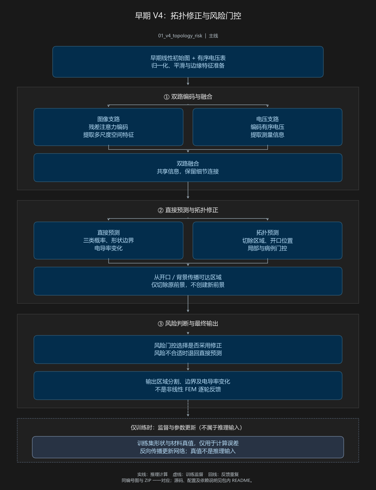

[代码 ZIP](packages/01_v4_topology_risk_code.zip) · [矢量流程图](diagrams/01_v4_topology_risk.svg) · [版本记录](records/01_v4_topology_risk.json)

### 02_v5_topology_risk | V5：面积保护与更保守的风险控制

延续早期 V4；主要改变训练约束、测量扰动训练与验证门槛，不表示所有病例都优于 V4。

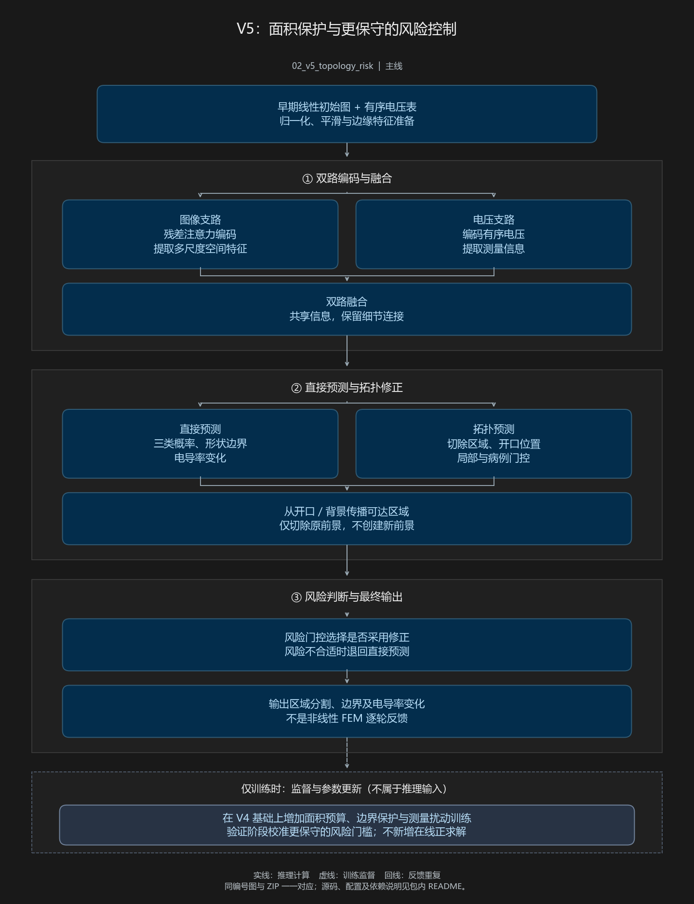

[代码 ZIP](packages/02_v5_topology_risk_code.zip) · [矢量流程图](diagrams/02_v5_topology_risk.svg) · [版本记录](records/02_v5_topology_risk.json)

### 03_v6_local_corrected | V6：局部修正与双风险门控

采用 corrected 记录。未加 corrected 的旧结果存在评估索引错误，不能据此报告性能。

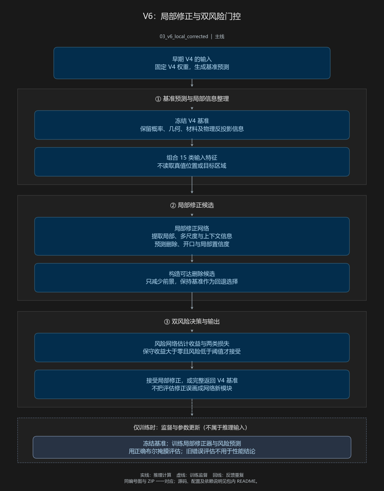

[代码 ZIP](packages/03_v6_local_corrected_code.zip) · [矢量流程图](diagrams/03_v6_local_corrected.svg) · [版本记录](records/03_v6_local_corrected.json)

### 04_v4_imported | 导入 V4：双频初始图与电压联合重建

20261015 导入包；7 通道初始图与 4 通道复电压。与本地 12 通道 V4 权重不通用。外部引擎／缓存并非全部随代码提供。

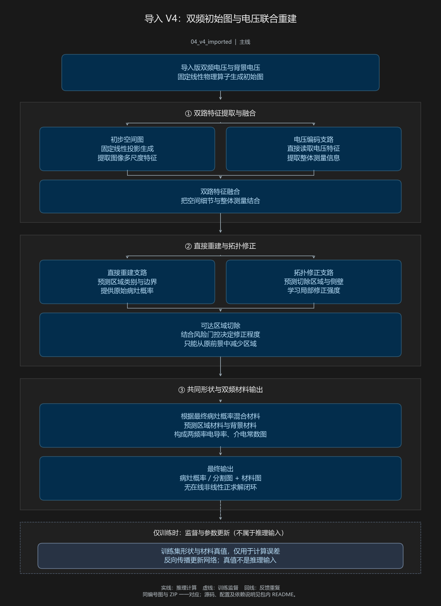

[代码 ZIP](packages/04_v4_imported_code.zip) · [矢量流程图](diagrams/04_v4_imported.svg) · [版本记录](records/04_v4_imported.json)

### 05_v4_imported_long | 导入 V4：延长耐心训练版

与上一项同架构，训练历史及检查点不同；不能把长训当成额外推理模块。

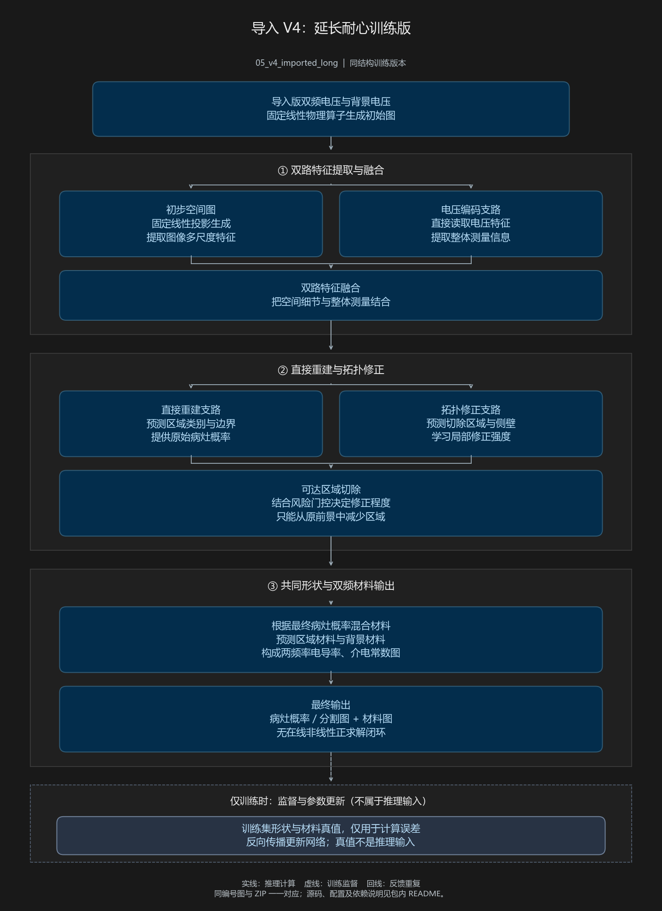

[代码 ZIP](packages/05_v4_imported_long_code.zip) · [矢量流程图](diagrams/05_v4_imported_long.svg) · [版本记录](records/05_v4_imported_long.json)

### 06_v4_3872_amplitude | V4 / 3872 数据：仅幅值

3872 例数据上的输入受控研究；不是最终 4840 数据实验。

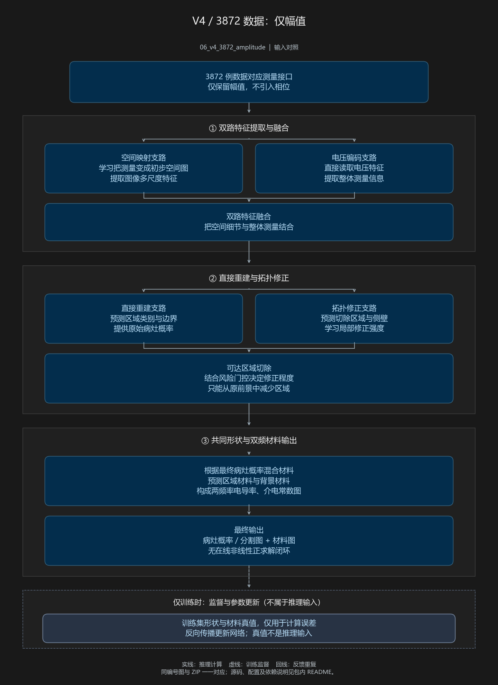

[代码 ZIP](packages/06_v4_3872_amplitude_code.zip) · [矢量流程图](diagrams/06_v4_3872_amplitude.svg) · [版本记录](records/06_v4_3872_amplitude.json)

### 07_v4_3872_complex | V4 / 3872 数据：复数电压

3872 例数据上的输入受控研究；不是最终 4840 数据实验。

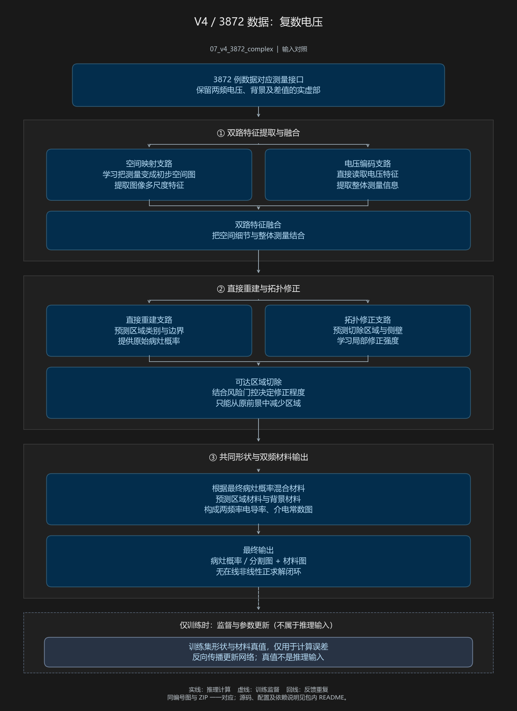

[代码 ZIP](packages/07_v4_3872_complex_code.zip) · [矢量流程图](diagrams/07_v4_3872_complex.svg) · [版本记录](records/07_v4_3872_complex.json)

### 08_v4_3872_calibrated | V4 / 3872 数据：背景校准复数电压

3872 例数据上的输入受控研究；不是最终 4840 数据实验。

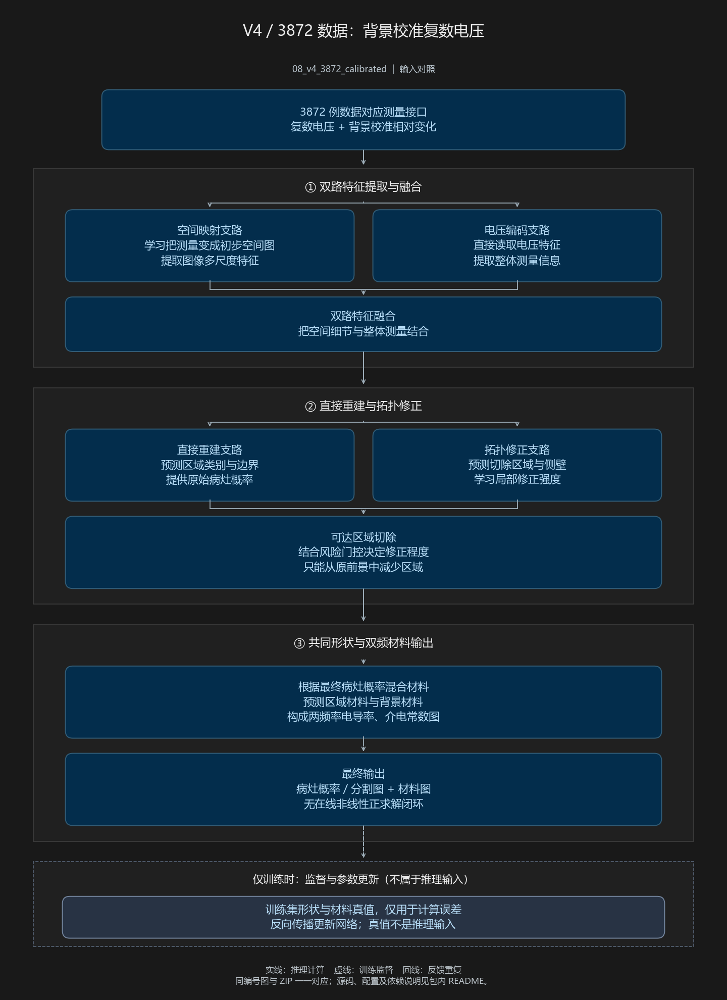

[代码 ZIP](packages/08_v4_3872_calibrated_code.zip) · [矢量流程图](diagrams/08_v4_3872_calibrated.svg) · [版本记录](records/08_v4_3872_calibrated.json)

### 09_v4_3872_amplitude_calibrated | V4 / 3872 数据：背景校准幅值

3872 例数据上的输入受控研究；不是最终 4840 数据实验。

[代码 ZIP](packages/09_v4_3872_amplitude_calibrated_code.zip) · [矢量流程图](diagrams/09_v4_3872_amplitude_calibrated.svg) · [版本记录](records/09_v4_3872_amplitude_calibrated.json)

### 10_v4_4840_formal50 | V4 / 4840 数据：校准输入 50 轮版

50 轮探索性适配，与后面的正式配对多种子实验区分。

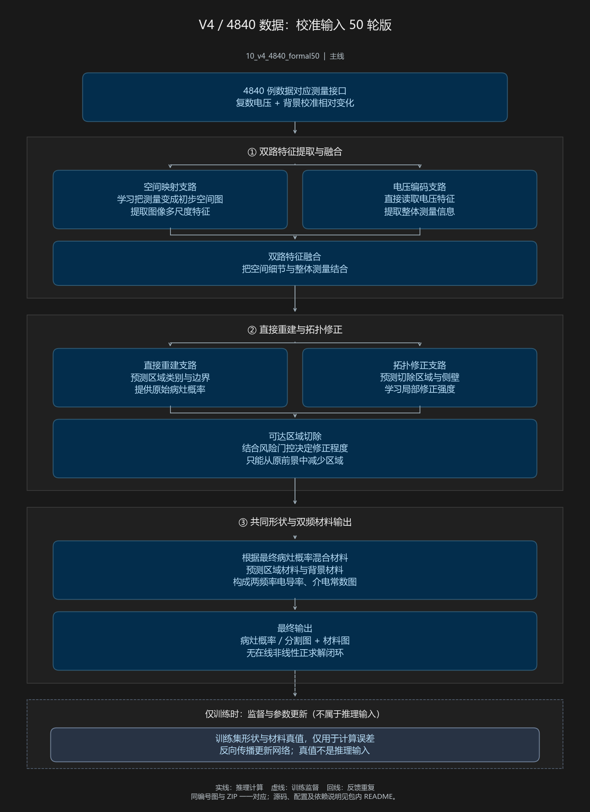

[代码 ZIP](packages/10_v4_4840_formal50_code.zip) · [矢量流程图](diagrams/10_v4_4840_formal50.svg) · [版本记录](records/10_v4_4840_formal50.json)

### 11_v4_4840_calibrated | V4 / 4840 正式对照：背景校准复数电压

相同结构的不同种子留在同一项，不拆成新模型。默认未启用额外物理初始图输入。

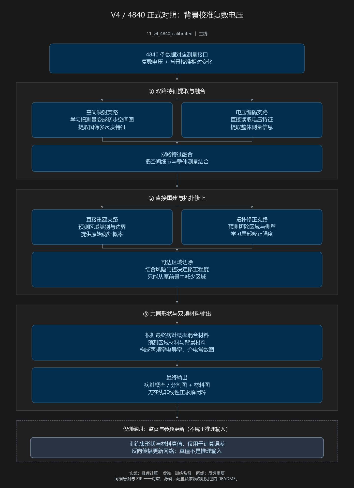

[代码 ZIP](packages/11_v4_4840_calibrated_code.zip) · [矢量流程图](diagrams/11_v4_4840_calibrated.svg) · [版本记录](records/11_v4_4840_calibrated.json)

### 12_v4_4840_amplitude | V4 / 4840 正式对照：仅幅值

相同结构的不同种子留在同一项，不拆成新模型。默认未启用额外物理初始图输入。

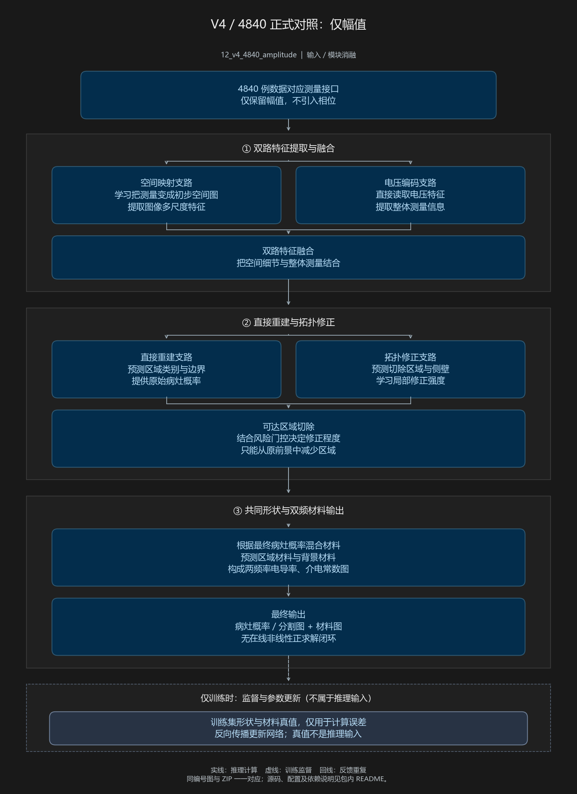

[代码 ZIP](packages/12_v4_4840_amplitude_code.zip) · [矢量流程图](diagrams/12_v4_4840_amplitude.svg) · [版本记录](records/12_v4_4840_amplitude.json)

### 13_v4_4840_complex | V4 / 4840 正式对照：复数电压

相同结构的不同种子留在同一项，不拆成新模型。默认未启用额外物理初始图输入。

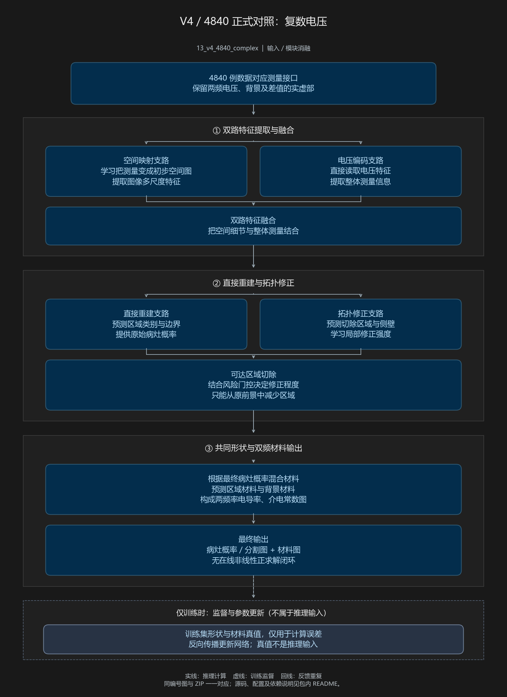

[代码 ZIP](packages/13_v4_4840_complex_code.zip) · [矢量流程图](diagrams/13_v4_4840_complex.svg) · [版本记录](records/13_v4_4840_complex.json)

### 14_v4_4840_amplitude_calibrated | V4 / 4840 正式对照：背景校准幅值

相同结构的不同种子留在同一项，不拆成新模型。默认未启用额外物理初始图输入。

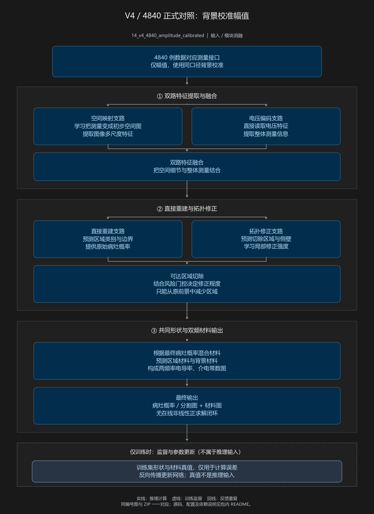

[代码 ZIP](packages/14_v4_4840_amplitude_calibrated_code.zip) · [矢量流程图](diagrams/14_v4_4840_amplitude_calibrated.svg) · [版本记录](records/14_v4_4840_amplitude_calibrated.json)

### 15_v4_4840_no_topology | V4 / 4840 正式对照：去除拓扑修正

相同结构的不同种子留在同一项，不拆成新模型。默认未启用额外物理初始图输入。

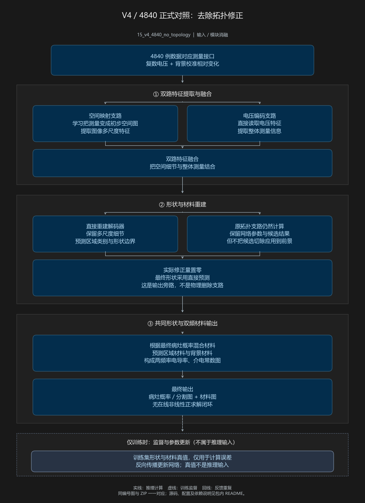

[代码 ZIP](packages/15_v4_4840_no_topology_code.zip) · [矢量流程图](diagrams/15_v4_4840_no_topology.svg) · [版本记录](records/15_v4_4840_no_topology.json)

### 16_v4_4840_no_risk | V4 / 4840 正式对照：去除风险门控

相同结构的不同种子留在同一项，不拆成新模型。默认未启用额外物理初始图输入。

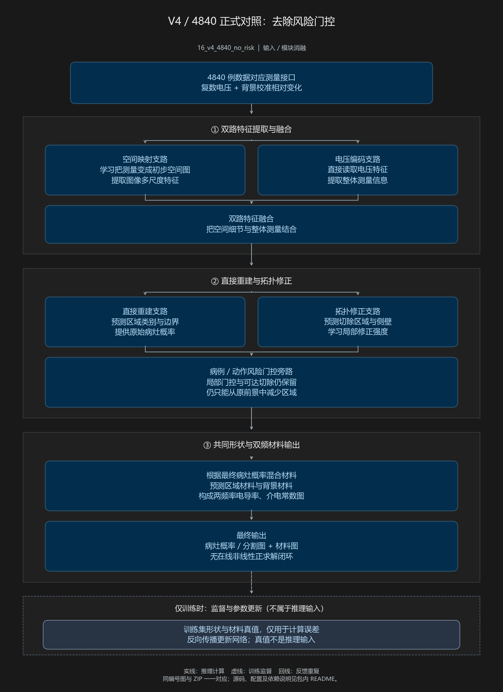

[代码 ZIP](packages/16_v4_4840_no_risk_code.zip) · [矢量流程图](diagrams/16_v4_4840_no_risk.svg) · [版本记录](records/16_v4_4840_no_risk.json)

### 17_v4_k1_feedback | 旧 V4 + 单轮修正

冻结 V4，只训练一次修正；非三轮联合闭环。历史 FEM 有像素覆盖近似，不能套用后来的覆盖验收。

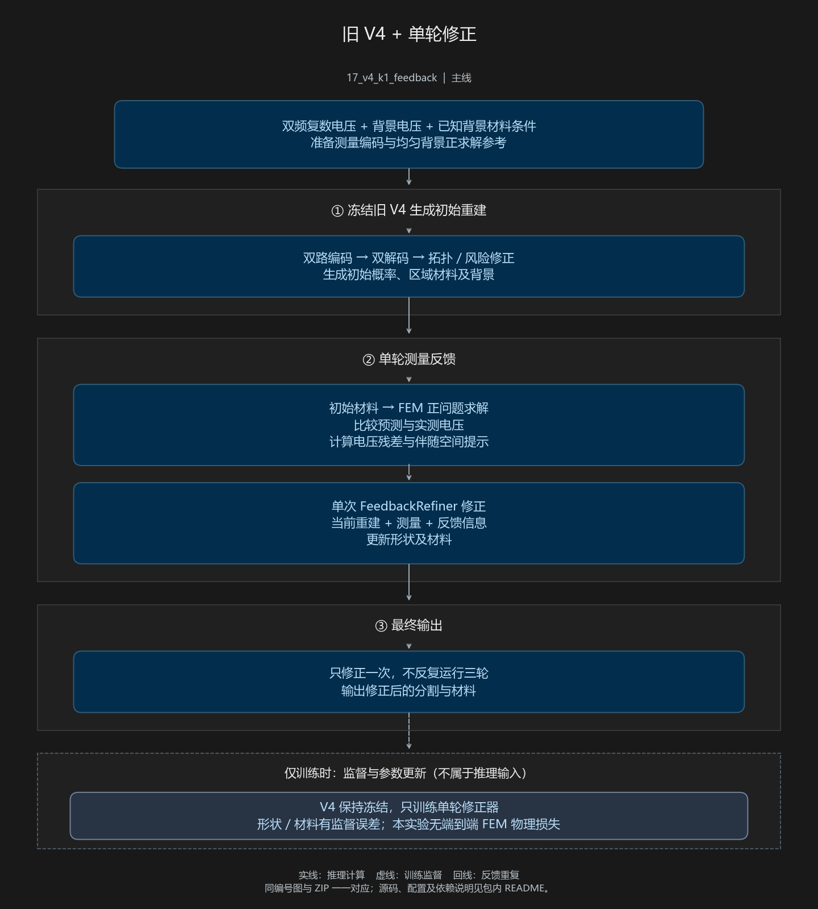

[代码 ZIP](packages/17_v4_k1_feedback_code.zip) · [矢量流程图](diagrams/17_v4_k1_feedback.svg) · [版本记录](records/17_v4_k1_feedback.json)

### 18_v4_k1_no_feedback | 旧 V4 + 单轮修正：无物理反馈对照

冻结 V4，只训练一次修正；非三轮联合闭环。历史 FEM 有像素覆盖近似，不能套用后来的覆盖验收。

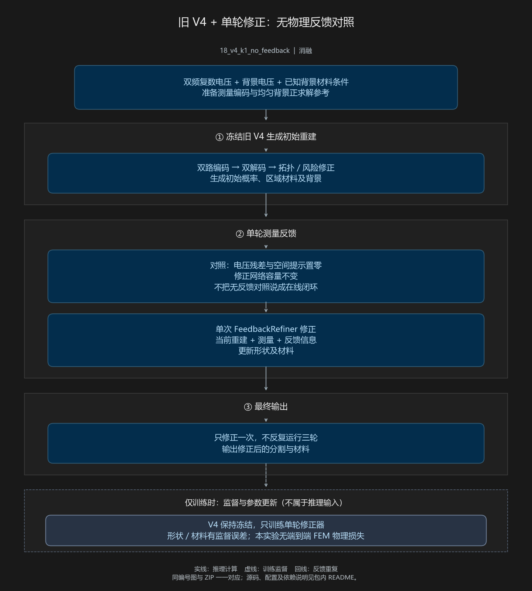

[代码 ZIP](packages/18_v4_k1_no_feedback_code.zip) · [矢量流程图](diagrams/18_v4_k1_no_feedback.svg) · [版本记录](records/18_v4_k1_no_feedback.json)

### 19_v4_k1_long_feedback | 旧 V4 + 单轮修正（多种子长训）

冻结 V4，只训练一次修正；非三轮联合闭环。历史 FEM 有像素覆盖近似，不能套用后来的覆盖验收。

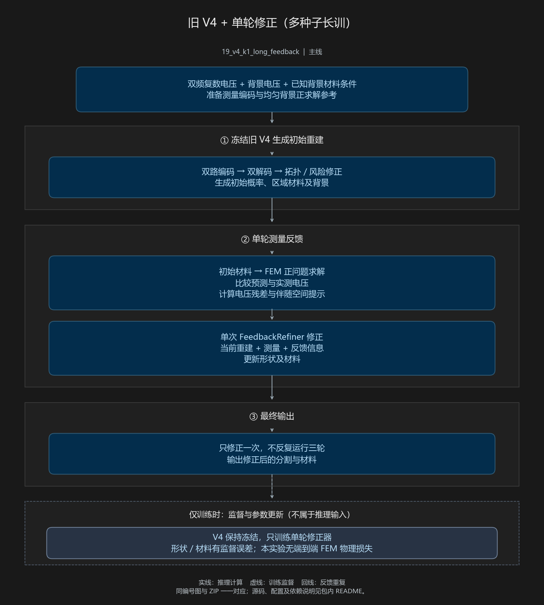

[代码 ZIP](packages/19_v4_k1_long_feedback_code.zip) · [矢量流程图](diagrams/19_v4_k1_long_feedback.svg) · [版本记录](records/19_v4_k1_long_feedback.json)

### 20_v4_k1_long_no_feedback | 旧 V4 + 单轮修正（多种子长训）：无物理反馈对照

冻结 V4，只训练一次修正；非三轮联合闭环。历史 FEM 有像素覆盖近似，不能套用后来的覆盖验收。

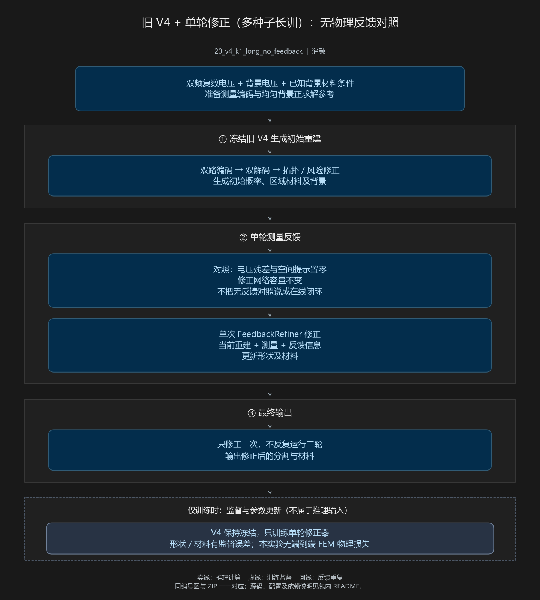

[代码 ZIP](packages/20_v4_k1_long_no_feedback_code.zip) · [矢量流程图](diagrams/20_v4_k1_long_no_feedback.svg) · [版本记录](records/20_v4_k1_long_no_feedback.json)

### 21_v4_k3_quick | 旧 V4 联合微调：固定三轮短训版

3 个完整 epoch，选第 2 轮；外凸研究前的旧 K3 对照。 历史 FEM 并非后来 3096 像素覆盖修订版。

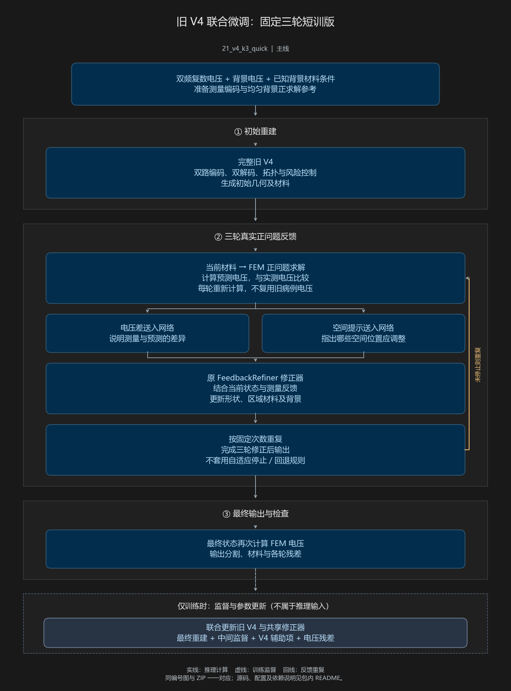

[代码 ZIP](packages/21_v4_k3_quick_code.zip) · [矢量流程图](diagrams/21_v4_k3_quick.svg) · [版本记录](records/21_v4_k3_quick.json)

### 22_v4_k3_long | 旧 V4 联合微调：三轮长训分支

保留原长训分支的实际状态，不恢复训练，也不声称它已完成。 历史 FEM 并非后来 3096 像素覆盖修订版。

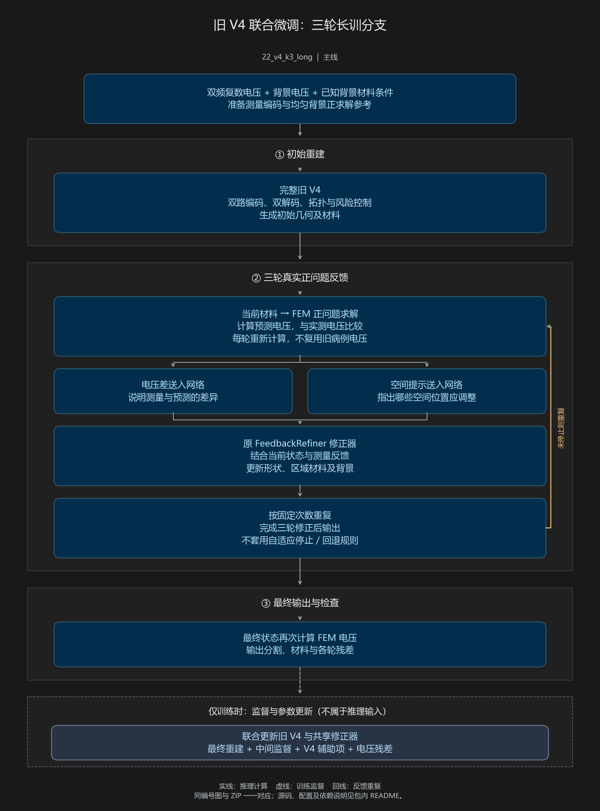

[代码 ZIP](packages/22_v4_k3_long_code.zip) · [矢量流程图](diagrams/22_v4_k3_long.svg) · [版本记录](records/22_v4_k3_long.json)

### 23_probe_delete_global | 外凸诊断：只减不增的全局修正

不是最终冻结模型。真值局部区域只用于训练／评价，不作为推理输入；单独读出实验不等于已通过完整闭环验证。

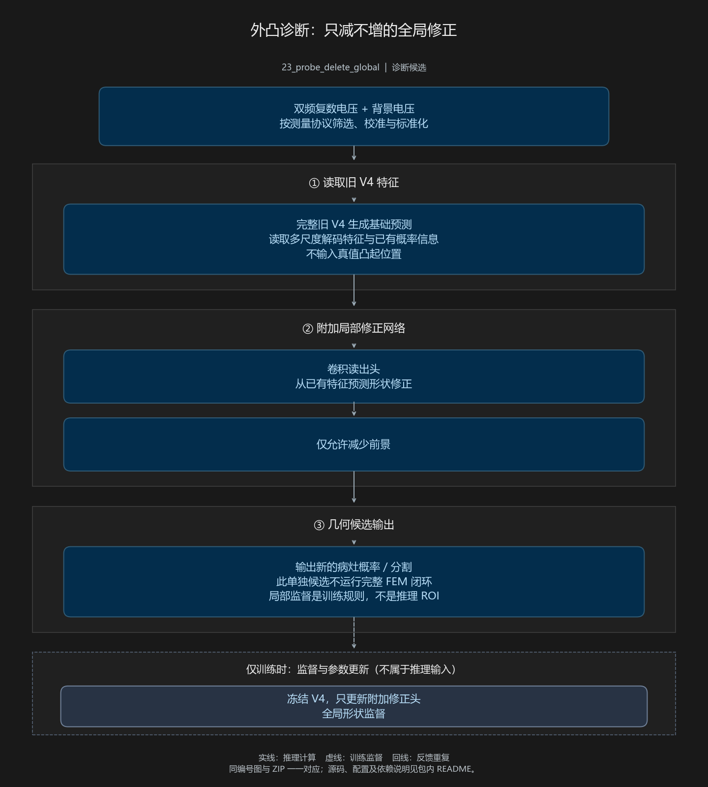

[代码 ZIP](packages/23_probe_delete_global_code.zip) · [矢量流程图](diagrams/23_probe_delete_global.svg) · [版本记录](records/23_probe_delete_global.json)

### 24_probe_signed_global | 外凸诊断：可增可减的全局修正

不是最终冻结模型。真值局部区域只用于训练／评价，不作为推理输入；单独读出实验不等于已通过完整闭环验证。

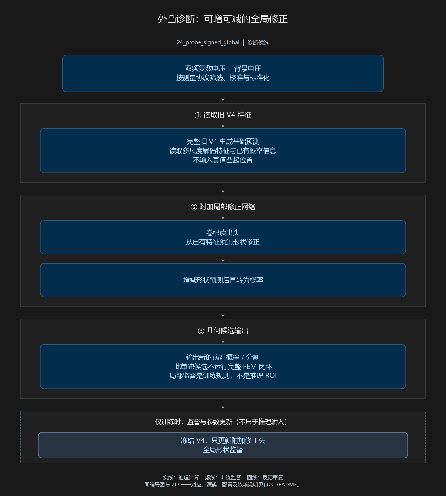

[代码 ZIP](packages/24_probe_signed_global_code.zip) · [矢量流程图](diagrams/24_probe_signed_global.svg) · [版本记录](records/24_probe_signed_global.json)

### 25_probe_signed_boundary | 外凸诊断：可增可减 + 边界监督

不是最终冻结模型。真值局部区域只用于训练／评价，不作为推理输入；单独读出实验不等于已通过完整闭环验证。

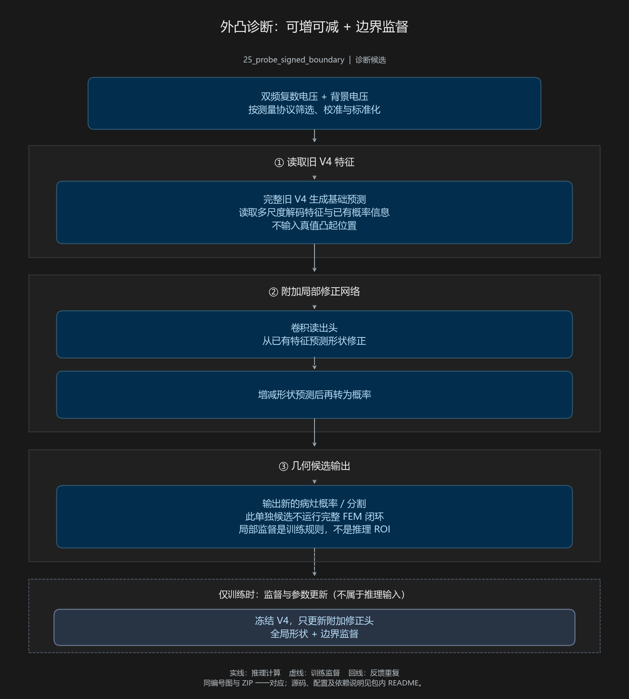

[代码 ZIP](packages/25_probe_signed_boundary_code.zip) · [矢量流程图](diagrams/25_probe_signed_boundary.svg) · [版本记录](records/25_probe_signed_boundary.json)

### 26_probe_signed_local | 外凸诊断：可增可减 + 局部监督

不是最终冻结模型。真值局部区域只用于训练／评价，不作为推理输入；单独读出实验不等于已通过完整闭环验证。

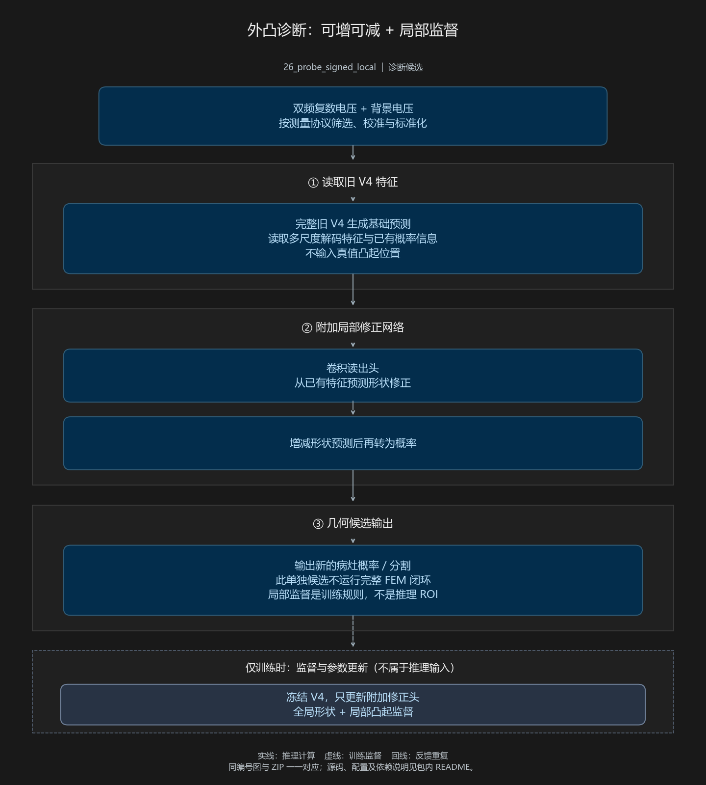

[代码 ZIP](packages/26_probe_signed_local_code.zip) · [矢量流程图](diagrams/26_probe_signed_local.svg) · [版本记录](records/26_probe_signed_local.json)

### 27_probe_probability_local | 外凸诊断：概率直接修正 + 局部监督

不是最终冻结模型。真值局部区域只用于训练／评价，不作为推理输入；单独读出实验不等于已通过完整闭环验证。

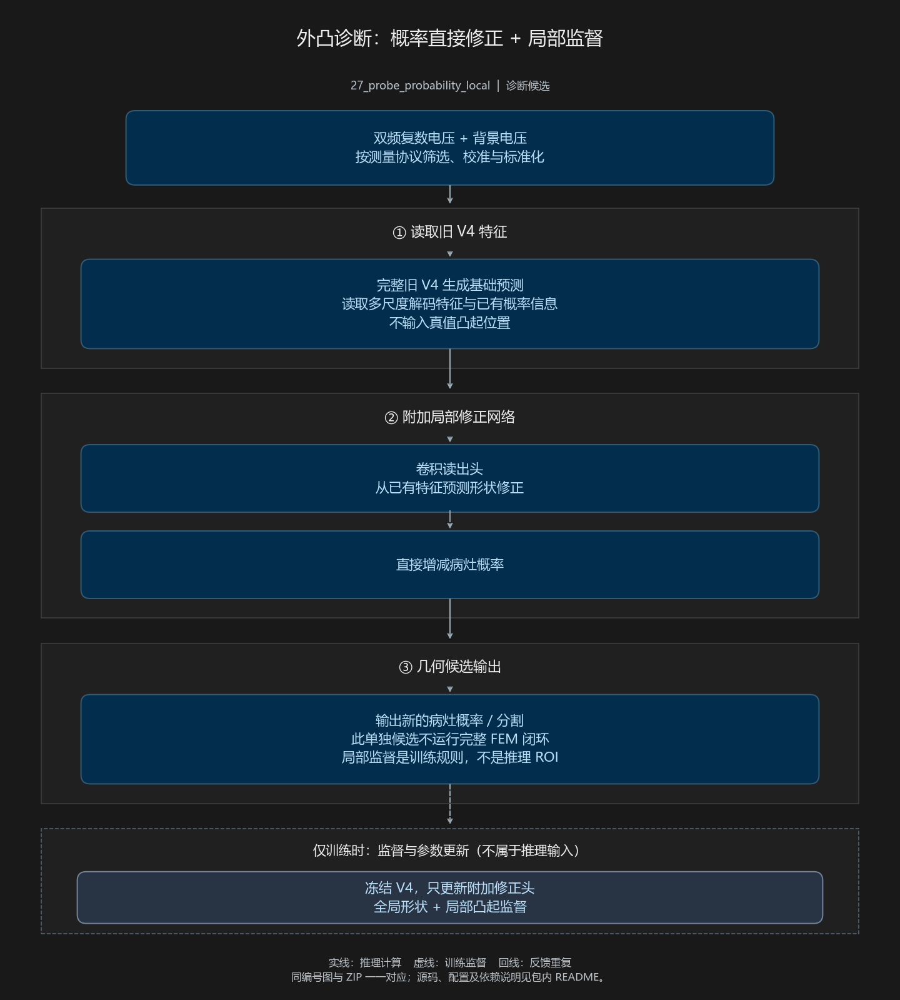

[代码 ZIP](packages/27_probe_probability_local_code.zip) · [矢量流程图](diagrams/27_probe_probability_local.svg) · [版本记录](records/27_probe_probability_local.json)

### 28_probe_joint_global | 外凸诊断：V4 联合训练 + 全局修正

不是最终冻结模型。真值局部区域只用于训练／评价，不作为推理输入；单独读出实验不等于已通过完整闭环验证。

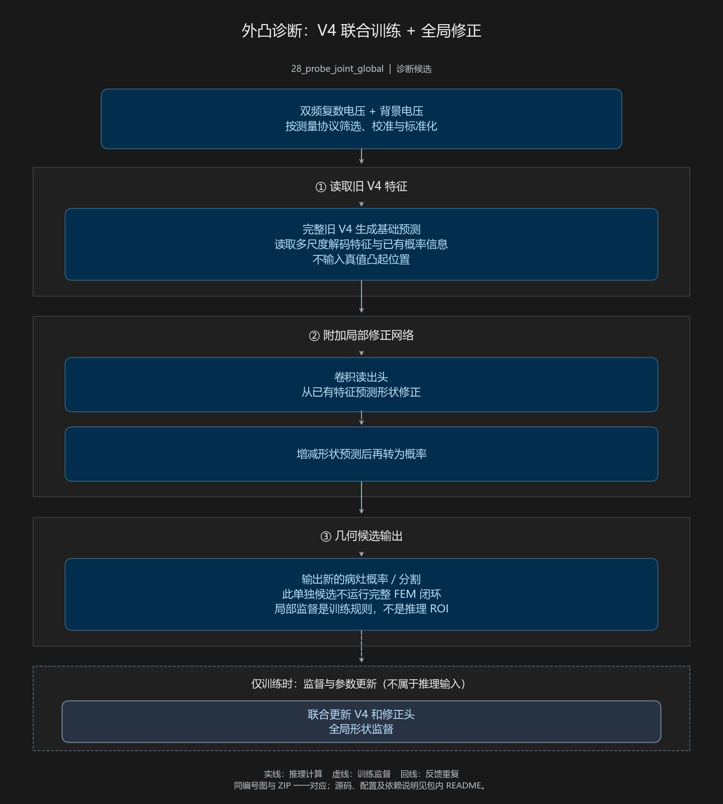

[代码 ZIP](packages/28_probe_joint_global_code.zip) · [矢量流程图](diagrams/28_probe_joint_global.svg) · [版本记录](records/28_probe_joint_global.json)

### 29_probe_joint_local | 外凸诊断：V4 联合训练 + 局部监督

不是最终冻结模型。真值局部区域只用于训练／评价，不作为推理输入；单独读出实验不等于已通过完整闭环验证。

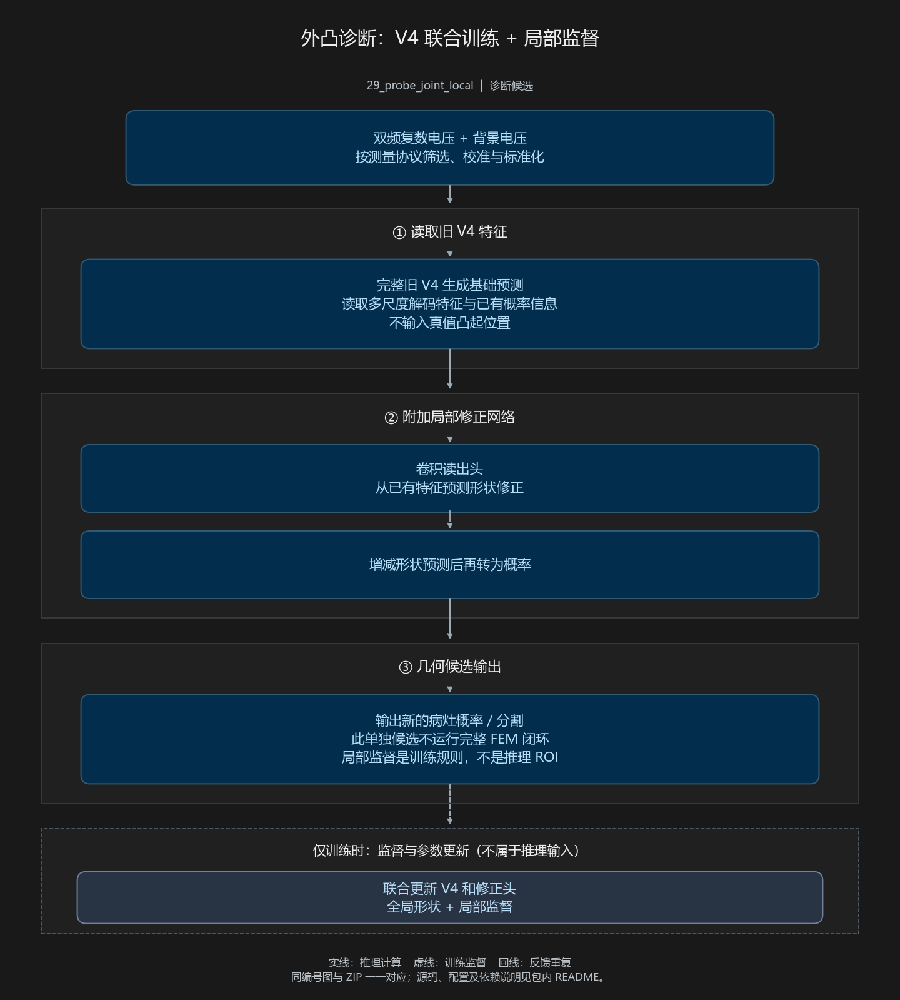

[代码 ZIP](packages/29_probe_joint_local_code.zip) · [矢量流程图](diagrams/29_probe_joint_local.svg) · [版本记录](records/29_probe_joint_local.json)

### 30_probe_joint_local_precise | 外凸诊断：联合局部监督 + 邻近误填约束

不是最终冻结模型。真值局部区域只用于训练／评价，不作为推理输入；单独读出实验不等于已通过完整闭环验证。

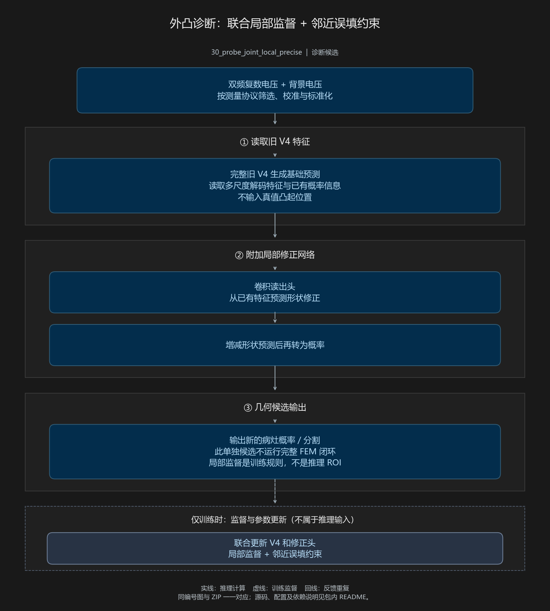

[代码 ZIP](packages/30_probe_joint_local_precise_code.zip) · [矢量流程图](diagrams/30_probe_joint_local_precise.svg) · [版本记录](records/30_probe_joint_local_precise.json)

### 31_probe_gate_control | 外凸诊断：预测边界带内的门控修正

不是最终冻结模型。真值局部区域只用于训练／评价，不作为推理输入；单独读出实验不等于已通过完整闭环验证。

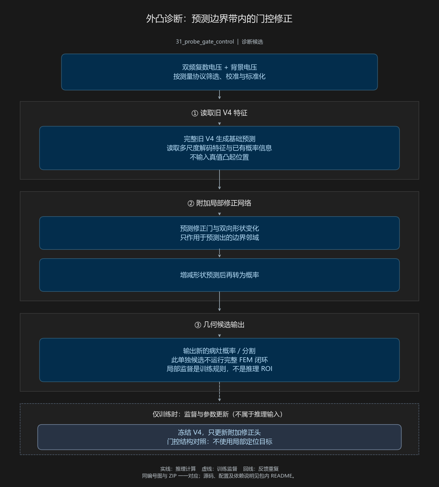

[代码 ZIP](packages/31_probe_gate_control_code.zip) · [矢量流程图](diagrams/31_probe_gate_control.svg) · [版本记录](records/31_probe_gate_control.json)

### 32_probe_gate_supervised | 外凸诊断：门控修正 + 局部定位监督

不是最终冻结模型。真值局部区域只用于训练／评价，不作为推理输入；单独读出实验不等于已通过完整闭环验证。

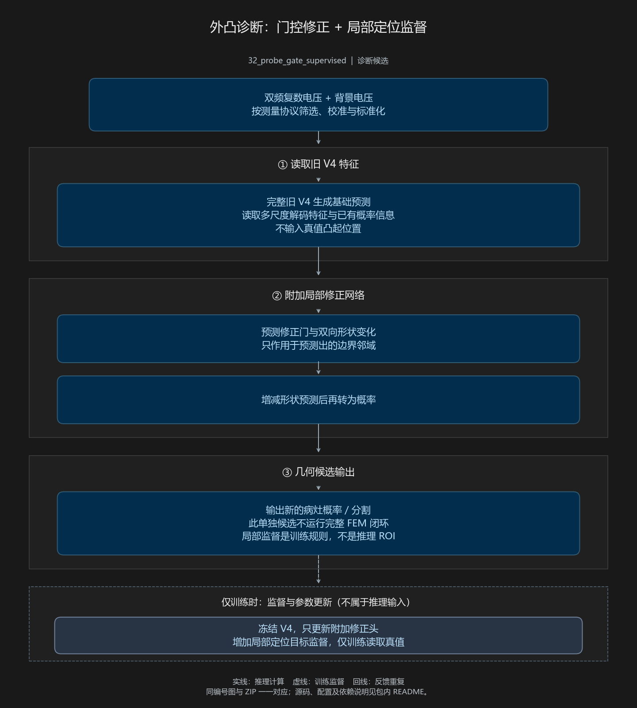

[代码 ZIP](packages/32_probe_gate_supervised_code.zip) · [矢量流程图](diagrams/32_probe_gate_supervised.svg) · [版本记录](records/32_probe_gate_supervised.json)

### 33_probe_k3_integration | 局部概率修正接入旧 K3 的验证版

probability_local 改初始几何并重新耦合材料，再接原 K3 修正器；不能视作重新联合训练的最佳模型。

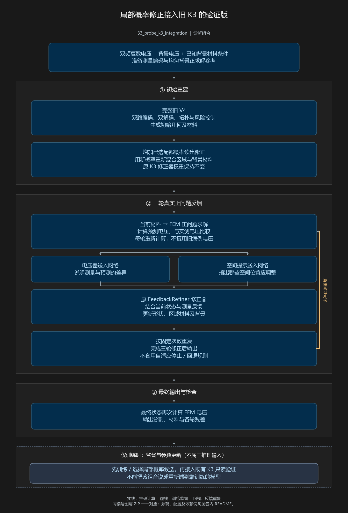

[代码 ZIP](packages/33_probe_k3_integration_code.zip) · [矢量流程图](diagrams/33_probe_k3_integration.svg) · [版本记录](records/33_probe_k3_integration.json)

### 34_shape1_single16 | 通用形状第一阶段：单通道低分辨率映射

全图通用形状与材料预测，无 V4 删除门控、完整 Champion 或在线 FEM。

[代码 ZIP](packages/34_shape1_single16_code.zip) · [矢量流程图](diagrams/34_shape1_single16.svg) · [版本记录](records/34_shape1_single16.json)

### 35_shape1_multi16 | 通用形状第一阶段：多通道低分辨率映射

全图通用形状与材料预测，无 V4 删除门控、完整 Champion 或在线 FEM。

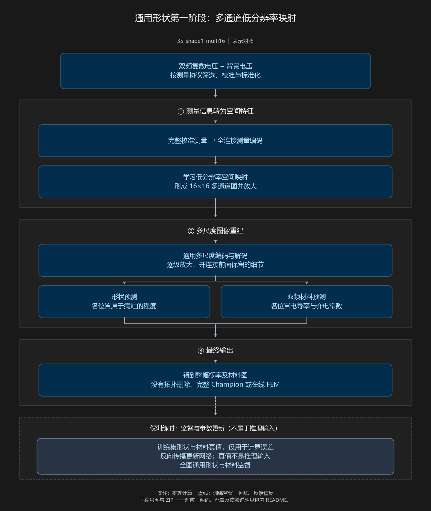

[代码 ZIP](packages/35_shape1_multi16_code.zip) · [矢量流程图](diagrams/35_shape1_multi16.svg) · [版本记录](records/35_shape1_multi16.json)

### 36_shape1_dense64 | 通用形状第一阶段：高分辨率直接映射

全图通用形状与材料预测，无 V4 删除门控、完整 Champion 或在线 FEM。

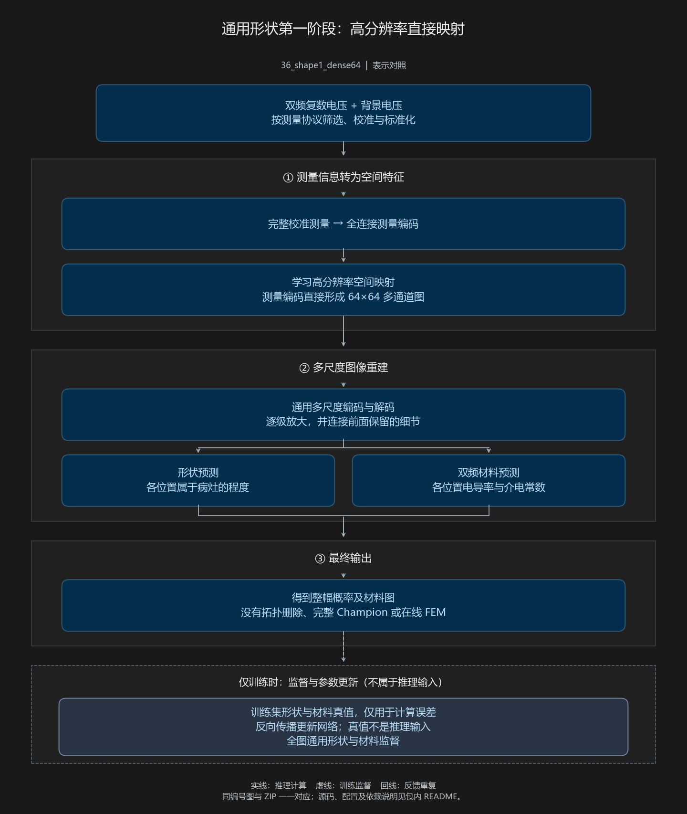

[代码 ZIP](packages/36_shape1_dense64_code.zip) · [矢量流程图](diagrams/36_shape1_dense64.svg) · [版本记录](records/36_shape1_dense64.json)

### 37_shape1_dense64_boundary | 通用形状第一阶段：高分辨率映射 + 边界监督

全图通用形状与材料预测，无 V4 删除门控、完整 Champion 或在线 FEM。

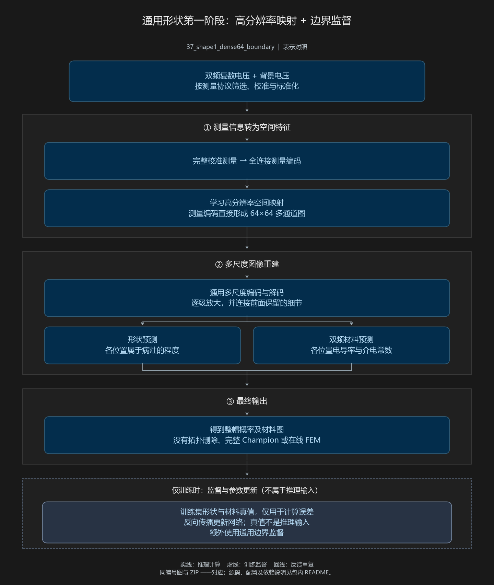

[代码 ZIP](packages/37_shape1_dense64_boundary_code.zip) · [矢量流程图](diagrams/37_shape1_dense64_boundary.svg) · [版本记录](records/37_shape1_dense64_boundary.json)

### 38_shape1_query_boundary | 通用形状第一阶段：逐位置查询 + 边界监督

全图通用形状与材料预测，无 V4 删除门控、完整 Champion 或在线 FEM。

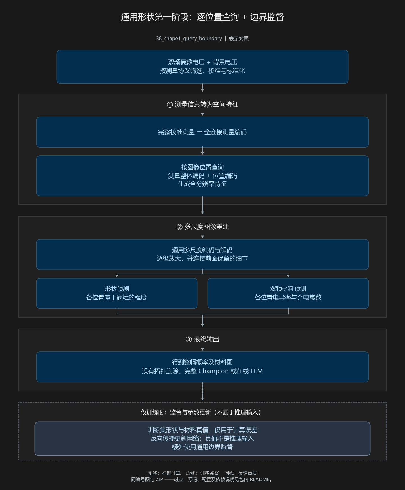

[代码 ZIP](packages/38_shape1_query_boundary_code.zip) · [矢量流程图](diagrams/38_shape1_query_boundary.svg) · [版本记录](records/38_shape1_query_boundary.json)

### 39_shape2_physical | 通用形状第二阶段：固定物理投影

固定投影不等于每次重新进行非线性 FEM 正求解；延长训练项延续原结构。

[代码 ZIP](packages/39_shape2_physical_code.zip) · [矢量流程图](diagrams/39_shape2_physical.svg) · [版本记录](records/39_shape2_physical.json)

### 40_shape2_physical_boundary | 通用形状第二阶段：固定物理投影 + 边界监督

固定投影不等于每次重新进行非线性 FEM 正求解；延长训练项延续原结构。

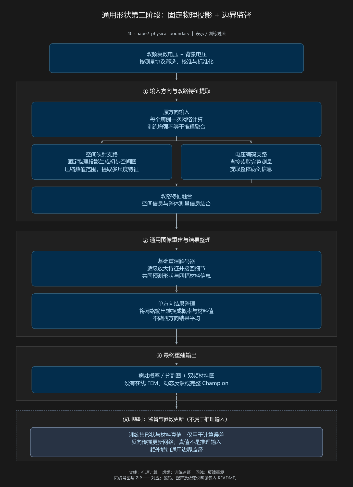

[代码 ZIP](packages/40_shape2_physical_boundary_code.zip) · [矢量流程图](diagrams/40_shape2_physical_boundary.svg) · [版本记录](records/40_shape2_physical_boundary.json)

### 41_shape2_multi16_extended | 通用形状第二阶段：多通道映射延长训练

沿用第一阶段的学习式测量到空间映射，延长训练；本项没有固定物理投影或在线 FEM。

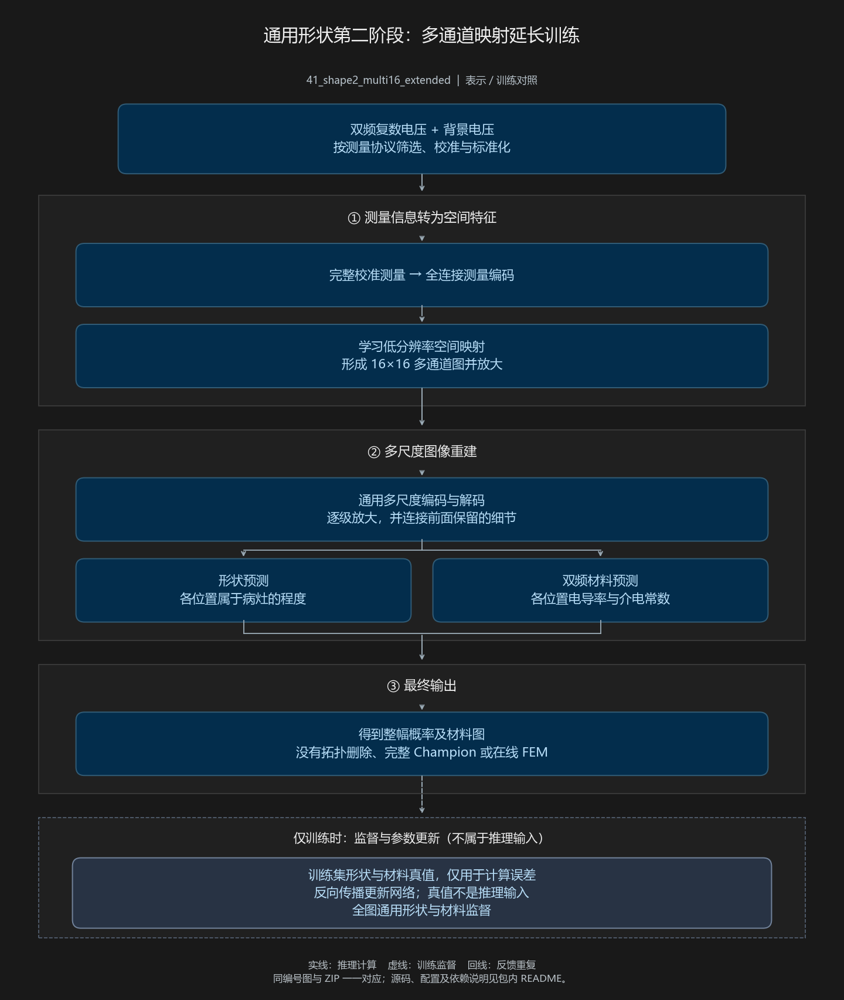

[代码 ZIP](packages/41_shape2_multi16_extended_code.zip) · [矢量流程图](diagrams/41_shape2_multi16_extended.svg) · [版本记录](records/41_shape2_multi16_extended.json)

### 42_shape2_dense64_boundary_extended | 通用形状第二阶段：高分辨率边界版延长训练

沿用第一阶段的学习式测量到空间映射，延长训练；本项没有固定物理投影或在线 FEM。

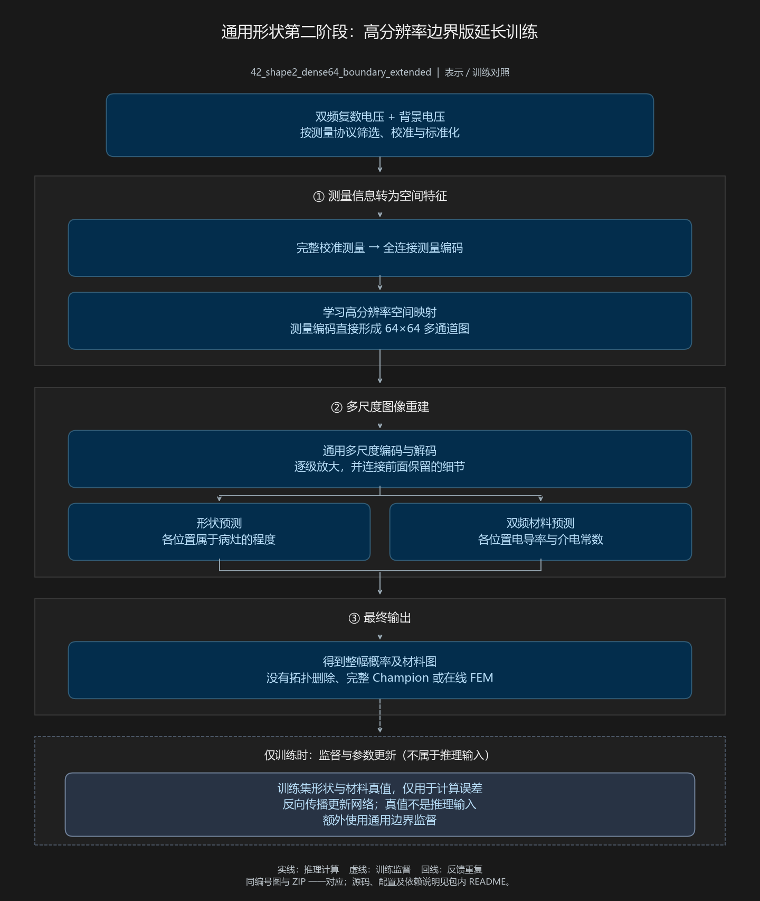

[代码 ZIP](packages/42_shape2_dense64_boundary_extended_code.zip) · [矢量流程图](diagrams/42_shape2_dense64_boundary_extended.svg) · [版本记录](records/42_shape2_dense64_boundary_extended.json)

### 43_shape3_physical_control | 通用形状第三阶段：固定投影：不加旋转训练对照

physical_c4 名称中的四方向是训练增强；这一历史评估路径在推理时只有一次网络计算。

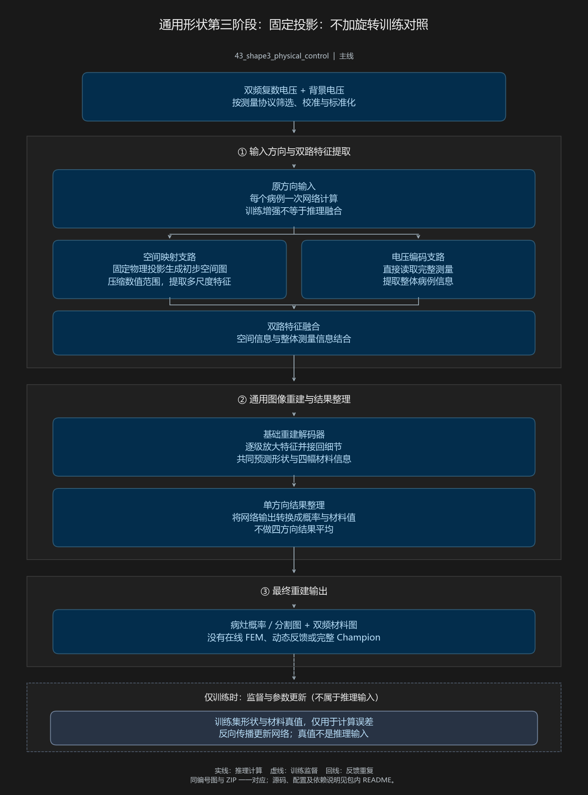

[代码 ZIP](packages/43_shape3_physical_control_code.zip) · [矢量流程图](diagrams/43_shape3_physical_control.svg) · [版本记录](records/43_shape3_physical_control.json)

### 44_shape3_physical_c4 | 通用形状第三阶段：固定投影：四方向训练增强版

physical_c4 名称中的四方向是训练增强；这一历史评估路径在推理时只有一次网络计算。

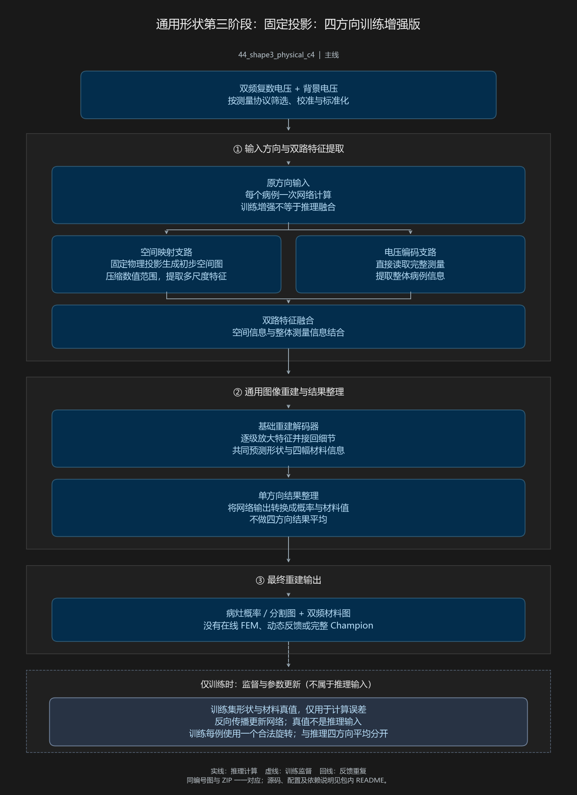

[代码 ZIP](packages/44_shape3_physical_c4_code.zip) · [矢量流程图](diagrams/44_shape3_physical_c4.svg) · [版本记录](records/44_shape3_physical_c4.json)

### 45_champion_full | 完整 Champion：四方向几何与区域材料重建

含电压注意力、双路骨干、细几何查询、方向融合与界面宽度；不是把旧 V4 代码原封不动并联在内。

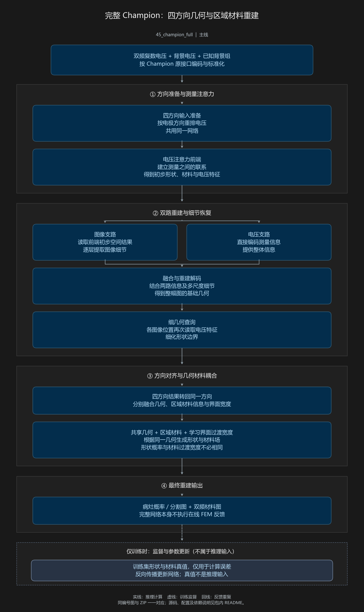

[代码 ZIP](packages/45_champion_full_code.zip) · [矢量流程图](diagrams/45_champion_full.svg) · [版本记录](records/45_champion_full.json)

### 46_projection_fixed3_loop | 投影四方向初始化 + 三轮场修正

早期集成原型，无独立完整训练权重；final_c4_loop 名称不代表完整 Champion。投影网络初始化与反馈零头不能冒充反馈已训练。历史网格未继承后续覆盖修订。

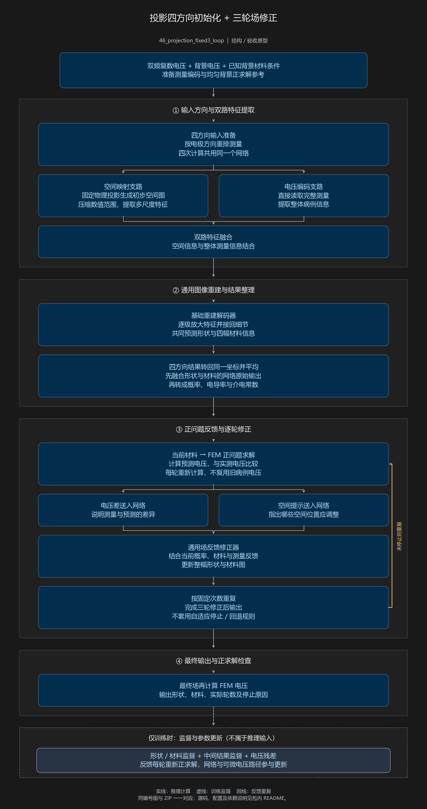

[代码 ZIP](packages/46_projection_fixed3_loop_code.zip) · [矢量流程图](diagrams/46_projection_fixed3_loop.svg) · [版本记录](records/46_projection_fixed3_loop.json)

### 47_champion_fixed3_loop | 完整 Champion + 三轮场修正

完成代码集成／接口验收，不是独立完整训练版本；默认预训练 Champion + 未训练反馈。以 Champion 替代初始化网络，没有同时保留完整旧 V4 闭环。

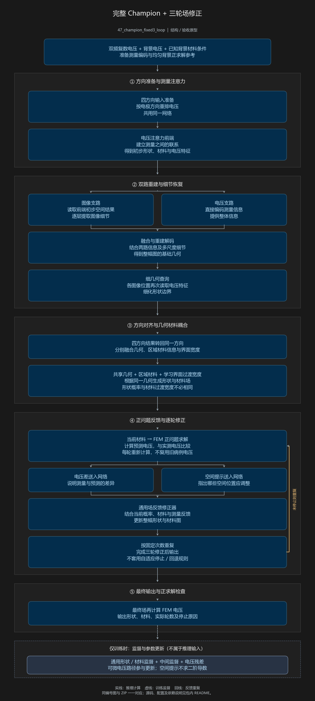

[代码 ZIP](packages/47_champion_fixed3_loop_code.zip) · [矢量流程图](diagrams/47_champion_fixed3_loop.svg) · [版本记录](records/47_champion_fixed3_loop.json)

### 48_champion_adaptive_loop | 完整 Champion + 自适应场修正

本项是自适应接口原型；完整短训权重见后续 c_adaptive。3096/3096 像素覆盖修订 FEM 仍非原 COMSOL 完全等价；稳定停止、回退与上限终止分开。

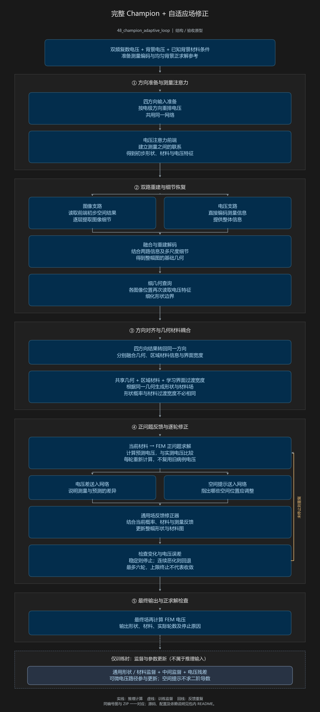

[代码 ZIP](packages/48_champion_adaptive_loop_code.zip) · [矢量流程图](diagrams/48_champion_adaptive_loop.svg) · [版本记录](records/48_champion_adaptive_loop.json)

### 49_short21_c_full | 21 组短训 / 完整 Champion，无反馈

各 256 次更新、batch 2；initial 是父模型预训练权重，不是随机初始化。初始／训练后都保留。原 18 小时限制已被用户取消，旧入口仅归档。

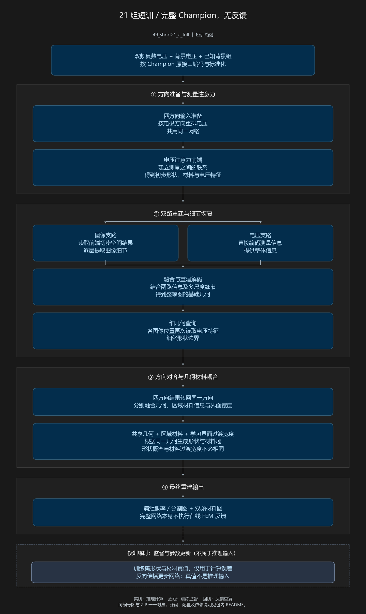

[代码 ZIP](packages/49_short21_c_full_code.zip) · [矢量流程图](diagrams/49_short21_c_full.svg) · [版本记录](records/49_short21_c_full.json)

### 50_short21_p_full | 21 组短训 / 投影四方向网络，无反馈

各 256 次更新、batch 2；initial 是父模型预训练权重，不是随机初始化。初始／训练后都保留。原 18 小时限制已被用户取消，旧入口仅归档。

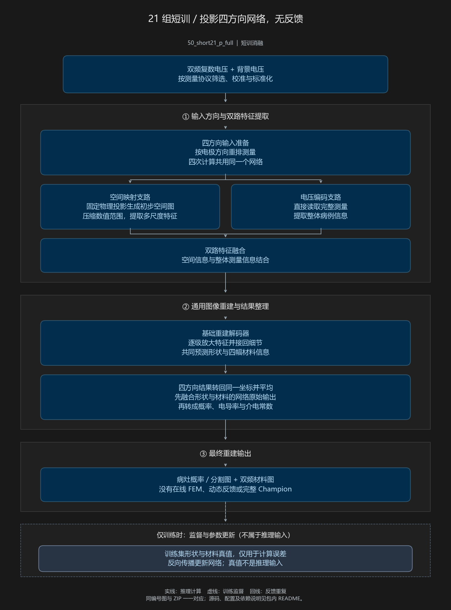

[代码 ZIP](packages/50_short21_p_full_code.zip) · [矢量流程图](diagrams/50_short21_p_full.svg) · [版本记录](records/50_short21_p_full.json)

### 51_short21_p_no_projection | 21 组短训 / 投影路线：空间投影置零

各 256 次更新、batch 2；initial 是父模型预训练权重，不是随机初始化。初始／训练后都保留。原 18 小时限制已被用户取消，旧入口仅归档。

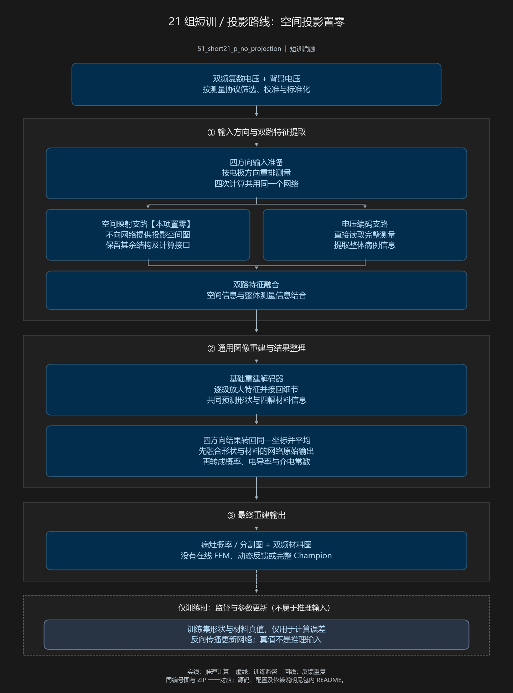

[代码 ZIP](packages/51_short21_p_no_projection_code.zip) · [矢量流程图](diagrams/51_short21_p_no_projection.svg) · [版本记录](records/51_short21_p_no_projection.json)

### 52_short21_p_no_context | 21 组短训 / 投影路线：全局电压支路置零

各 256 次更新、batch 2；initial 是父模型预训练权重，不是随机初始化。初始／训练后都保留。原 18 小时限制已被用户取消，旧入口仅归档。

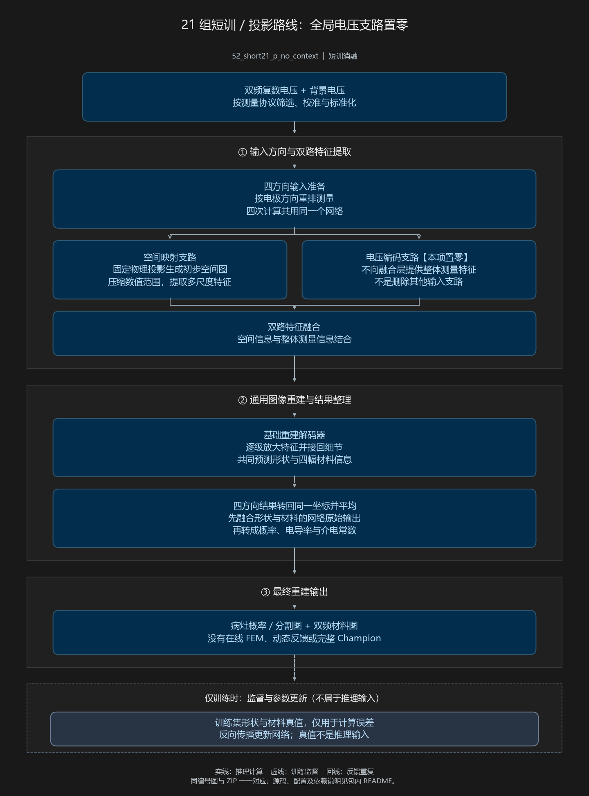

[代码 ZIP](packages/52_short21_p_no_context_code.zip) · [矢量流程图](diagrams/52_short21_p_no_context.svg) · [版本记录](records/52_short21_p_no_context.json)

### 53_short21_p_no_c4 | 21 组短训 / 投影路线：取消推理四方向融合

各 256 次更新、batch 2；initial 是父模型预训练权重，不是随机初始化。初始／训练后都保留。原 18 小时限制已被用户取消，旧入口仅归档。

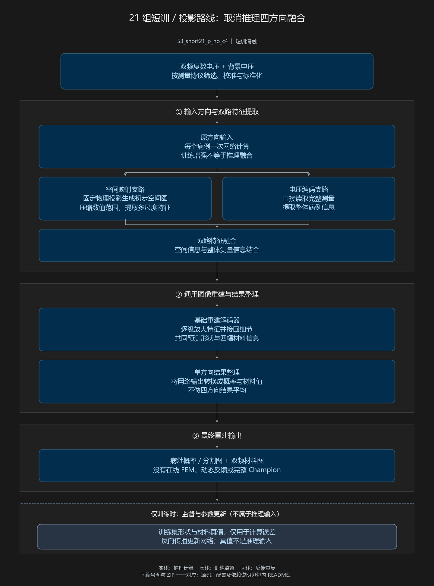

[代码 ZIP](packages/53_short21_p_no_c4_code.zip) · [矢量流程图](diagrams/53_short21_p_no_c4.svg) · [版本记录](records/53_short21_p_no_c4.json)

### 54_short21_c_no_c4 | 21 组短训 / Champion：取消推理四方向融合

各 256 次更新、batch 2；initial 是父模型预训练权重，不是随机初始化。初始／训练后都保留。原 18 小时限制已被用户取消，旧入口仅归档。

[代码 ZIP](packages/54_short21_c_no_c4_code.zip) · [矢量流程图](diagrams/54_short21_c_no_c4.svg) · [版本记录](records/54_short21_c_no_c4.json)

### 55_short21_c_no_query | 21 组短训 / Champion：取消细几何查询

各 256 次更新、batch 2；initial 是父模型预训练权重，不是随机初始化。初始／训练后都保留。原 18 小时限制已被用户取消，旧入口仅归档。

[代码 ZIP](packages/55_short21_c_no_query_code.zip) · [矢量流程图](diagrams/55_short21_c_no_query.svg) · [版本记录](records/55_short21_c_no_query.json)

### 56_short21_c_fixed_width | 21 组短训 / Champion：固定界面宽度

各 256 次更新、batch 2；initial 是父模型预训练权重，不是随机初始化。初始／训练后都保留。原 18 小时限制已被用户取消，旧入口仅归档。

[代码 ZIP](packages/56_short21_c_fixed_width_code.zip) · [矢量流程图](diagrams/56_short21_c_fixed_width.svg) · [版本记录](records/56_short21_c_fixed_width.json)

### 57_short21_c_front_only | 21 组短训 / Champion：只保留注意力前端输出

各 256 次更新、batch 2；initial 是父模型预训练权重，不是随机初始化。初始／训练后都保留。原 18 小时限制已被用户取消，旧入口仅归档。

[代码 ZIP](packages/57_short21_c_front_only_code.zip) · [矢量流程图](diagrams/57_short21_c_front_only.svg) · [版本记录](records/57_short21_c_front_only.json)

### 58_short21_c_no_image | 21 组短训 / Champion：图像支路输入置零

各 256 次更新、batch 2；initial 是父模型预训练权重，不是随机初始化。初始／训练后都保留。原 18 小时限制已被用户取消，旧入口仅归档。

[代码 ZIP](packages/58_short21_c_no_image_code.zip) · [矢量流程图](diagrams/58_short21_c_no_image.svg) · [版本记录](records/58_short21_c_no_image.json)

### 59_short21_c_no_voltage_encoder | 21 组短训 / Champion：骨干电压编码输出置零

各 256 次更新、batch 2；initial 是父模型预训练权重，不是随机初始化。初始／训练后都保留。原 18 小时限制已被用户取消，旧入口仅归档。

[代码 ZIP](packages/59_short21_c_no_voltage_encoder_code.zip) · [矢量流程图](diagrams/59_short21_c_no_voltage_encoder.svg) · [版本记录](records/59_short21_c_no_voltage_encoder.json)

### 60_short21_c_no_bce | 21 组短训 / Champion：去除像素分类损失

各 256 次更新、batch 2；initial 是父模型预训练权重，不是随机初始化。初始／训练后都保留。原 18 小时限制已被用户取消，旧入口仅归档。

[代码 ZIP](packages/60_short21_c_no_bce_code.zip) · [矢量流程图](diagrams/60_short21_c_no_bce.svg) · [版本记录](records/60_short21_c_no_bce.json)

### 61_short21_c_no_dice | 21 组短训 / Champion：去除区域重叠损失

各 256 次更新、batch 2；initial 是父模型预训练权重，不是随机初始化。初始／训练后都保留。原 18 小时限制已被用户取消，旧入口仅归档。

[代码 ZIP](packages/61_short21_c_no_dice_code.zip) · [矢量流程图](diagrams/61_short21_c_no_dice.svg) · [版本记录](records/61_short21_c_no_dice.json)

### 62_short21_c_no_material | 21 组短训 / Champion：去除材料监督损失

各 256 次更新、batch 2；initial 是父模型预训练权重，不是随机初始化。初始／训练后都保留。原 18 小时限制已被用户取消，旧入口仅归档。

[代码 ZIP](packages/62_short21_c_no_material_code.zip) · [矢量流程图](diagrams/62_short21_c_no_material.svg) · [版本记录](records/62_short21_c_no_material.json)

### 63_short21_c_adaptive | 21 组短训 / Champion + 自适应反馈

各 256 次更新、batch 2；initial 是父模型预训练权重，不是随机初始化。初始／训练后都保留。原 18 小时限制已被用户取消，旧入口仅归档。

[代码 ZIP](packages/63_short21_c_adaptive_code.zip) · [矢量流程图](diagrams/63_short21_c_adaptive.svg) · [版本记录](records/63_short21_c_adaptive.json)

### 64_short21_c_fixed3 | 21 组短训 / Champion + 固定三轮反馈

各 256 次更新、batch 2；initial 是父模型预训练权重，不是随机初始化。初始／训练后都保留。原 18 小时限制已被用户取消，旧入口仅归档。

[代码 ZIP](packages/64_short21_c_fixed3_code.zip) · [矢量流程图](diagrams/64_short21_c_fixed3.svg) · [版本记录](records/64_short21_c_fixed3.json)

### 65_short21_c_no_hint | 21 组短训 / 自适应 Champion：空间提示置零

各 256 次更新、batch 2；initial 是父模型预训练权重，不是随机初始化。初始／训练后都保留。原 18 小时限制已被用户取消，旧入口仅归档。

[代码 ZIP](packages/65_short21_c_no_hint_code.zip) · [矢量流程图](diagrams/65_short21_c_no_hint.svg) · [版本记录](records/65_short21_c_no_hint.json)

### 66_short21_c_no_residual | 21 组短训 / 自适应 Champion：残差输入置零

各 256 次更新、batch 2；initial 是父模型预训练权重，不是随机初始化。初始／训练后都保留。原 18 小时限制已被用户取消，旧入口仅归档。

[代码 ZIP](packages/66_short21_c_no_residual_code.zip) · [矢量流程图](diagrams/66_short21_c_no_residual.svg) · [版本记录](records/66_short21_c_no_residual.json)

### 67_short21_c_no_physics_loss | 21 组短训 / 自适应 Champion：去除电压残差损失

各 256 次更新、batch 2；initial 是父模型预训练权重，不是随机初始化。初始／训练后都保留。原 18 小时限制已被用户取消，旧入口仅归档。

[代码 ZIP](packages/67_short21_c_no_physics_loss_code.zip) · [矢量流程图](diagrams/67_short21_c_no_physics_loss.svg) · [版本记录](records/67_short21_c_no_physics_loss.json)

### 68_short21_c_no_auxiliary | 21 组短训 / 自适应 Champion：去除中间监督

各 256 次更新、batch 2；initial 是父模型预训练权重，不是随机初始化。初始／训练后都保留。原 18 小时限制已被用户取消，旧入口仅归档。

[代码 ZIP](packages/68_short21_c_no_auxiliary_code.zip) · [矢量流程图](diagrams/68_short21_c_no_auxiliary.svg) · [版本记录](records/68_short21_c_no_auxiliary.json)

### 69_short21_p_adaptive | 21 组短训 / 投影四方向网络 + 自适应反馈

各 256 次更新、batch 2；initial 是父模型预训练权重，不是随机初始化。初始／训练后都保留。原 18 小时限制已被用户取消，旧入口仅归档。

[代码 ZIP](packages/69_short21_p_adaptive_code.zip) · [矢量流程图](diagrams/69_short21_p_adaptive.svg) · [版本记录](records/69_short21_p_adaptive.json)

### 70_release_v1 | 历史短训发布快照 v1（已取代）

发布快照不是新增架构，更不是本次跨轮次最终最优结论；保留原 SUPERSEDED 标记。

[代码 ZIP](packages/70_release_v1_code.zip) · [矢量流程图](diagrams/70_release_v1.svg) · [版本记录](records/70_release_v1.json)

### 71_release_v2 | 历史短训发布快照 v2（已取代）

发布快照不是新增架构，更不是本次跨轮次最终最优结论；保留原 SUPERSEDED 标记。

[代码 ZIP](packages/71_release_v2_code.zip) · [矢量流程图](diagrams/71_release_v2.svg) · [版本记录](records/71_release_v2.json)

### 72_old_champion_oc_fixed3 | 8 组共同底座 / 旧 V4 闭环 + Champion，固定三轮

完整旧 V4 与原修正器未被替换；并联完整 Champion，投影版再加独立完整支路。动态轮数只控制旧闭环，融合后另算 FEM。

[代码 ZIP](packages/72_old_champion_oc_fixed3_code.zip) · [矢量流程图](diagrams/72_old_champion_oc_fixed3.svg) · [版本记录](records/72_old_champion_oc_fixed3.json)

### 73_old_champion_oc_adaptive | 8 组共同底座 / 旧 V4 闭环 + Champion，自适应

完整旧 V4 与原修正器未被替换；并联完整 Champion，投影版再加独立完整支路。动态轮数只控制旧闭环，融合后另算 FEM。

[代码 ZIP](packages/73_old_champion_oc_adaptive_code.zip) · [矢量流程图](diagrams/73_old_champion_oc_adaptive.svg) · [版本记录](records/73_old_champion_oc_adaptive.json)

### 74_old_champion_ocp_fixed3 | 8 组共同底座 / 旧 V4 闭环 + Champion + 投影，固定三轮

完整旧 V4 与原修正器未被替换；并联完整 Champion，投影版再加独立完整支路。动态轮数只控制旧闭环，融合后另算 FEM。

[代码 ZIP](packages/74_old_champion_ocp_fixed3_code.zip) · [矢量流程图](diagrams/74_old_champion_ocp_fixed3.svg) · [版本记录](records/74_old_champion_ocp_fixed3.json)

### 75_old_champion_ocp_adaptive | 8 组共同底座 / 旧 V4 闭环 + Champion + 投影，自适应

完整旧 V4 与原修正器未被替换；并联完整 Champion，投影版再加独立完整支路。动态轮数只控制旧闭环，融合后另算 FEM。

[代码 ZIP](packages/75_old_champion_ocp_adaptive_code.zip) · [矢量流程图](diagrams/75_old_champion_ocp_adaptive.svg) · [版本记录](records/75_old_champion_ocp_adaptive.json)

### 76_old_champion_selected_no_hint | 8 组共同底座 / 选中共同底座：空间提示置零

完整旧 V4 与原修正器未被替换；并联完整 Champion，投影版再加独立完整支路。动态轮数只控制旧闭环，融合后另算 FEM。

[代码 ZIP](packages/76_old_champion_selected_no_hint_code.zip) · [矢量流程图](diagrams/76_old_champion_selected_no_hint.svg) · [版本记录](records/76_old_champion_selected_no_hint.json)

### 77_old_champion_selected_no_residual | 8 组共同底座 / 选中共同底座：残差输入置零

完整旧 V4 与原修正器未被替换；并联完整 Champion，投影版再加独立完整支路。动态轮数只控制旧闭环，融合后另算 FEM。

[代码 ZIP](packages/77_old_champion_selected_no_residual_code.zip) · [矢量流程图](diagrams/77_old_champion_selected_no_residual.svg) · [版本记录](records/77_old_champion_selected_no_residual.json)

### 78_old_champion_selected_no_physics | 8 组共同底座 / 选中共同底座：去除物理损失

完整旧 V4 与原修正器未被替换；并联完整 Champion，投影版再加独立完整支路。动态轮数只控制旧闭环，融合后另算 FEM。

[代码 ZIP](packages/78_old_champion_selected_no_physics_code.zip) · [矢量流程图](diagrams/78_old_champion_selected_no_physics.svg) · [版本记录](records/78_old_champion_selected_no_physics.json)

### 79_old_champion_selected_no_auxiliary | 8 组共同底座 / 选中共同底座：去除中间监督

完整旧 V4 与原修正器未被替换；并联完整 Champion，投影版再加独立完整支路。动态轮数只控制旧闭环，融合后另算 FEM。

[代码 ZIP](packages/79_old_champion_selected_no_auxiliary_code.zip) · [矢量流程图](diagrams/79_old_champion_selected_no_auxiliary.svg) · [版本记录](records/79_old_champion_selected_no_auxiliary.json)

### 80_final_A_phase3_seed25 | 最终候选 A：历史 phase3 独立版

选定 seed20261025 的 best；单次推理。与 B 的父权重、种子和训练历史不同，不能当成纯方向融合消融。

[代码 ZIP](packages/80_final_A_phase3_seed25_code.zip) · [矢量流程图](diagrams/80_final_A_phase3_seed25.svg) · [版本记录](records/80_final_A_phase3_seed25.json)

### 81_final_B_p_full_initial | 最终候选 B：p_full 预训练初始版

选定 initial.pt；源于 seed20261023 父模型。四方向共用权重，先对齐并平均形状及材料潜在输出，再转换为数值。

[代码 ZIP](packages/81_final_B_p_full_initial_code.zip) · [矢量流程图](diagrams/81_final_B_p_full_initial.svg) · [版本记录](records/81_final_B_p_full_initial.json)

### 82_A_same_weight_c4 | A 的同权重四方向推理验证版

固定 A 权重，只改变推理包装；不同于 B 的父模型，也不是新训练。

[代码 ZIP](packages/82_A_same_weight_c4_code.zip) · [矢量流程图](diagrams/82_A_same_weight_c4.svg) · [版本记录](records/82_A_same_weight_c4.json)

### 83_phase3_c4_long | phase3 四方向继续训练冻结版

从 A 的历史权重继续训练；训练每例一个旋转，验证／推理四方向。保存的冻结版本与 A、B 均需区分；归档不恢复训练。

[代码 ZIP](packages/83_phase3_c4_long_code.zip) · [矢量流程图](diagrams/83_phase3_c4_long.svg) · [版本记录](records/83_phase3_c4_long.json)

